# 内容社区 (Content Sharing Platform)

一个内容社区前端 + 后端项目（功能形态参考小红书，视觉层是自建的工业 HUD 风格）。**PC 桌面端**布局，组件层使用 Element Plus（完全接管其主题变量），后端**零 ORM、零状态管理框架**（SQL 全部手写）、本地 SQLite 存储；除 Express / ws / multer / better-sqlite3 这类基础库外没有别的运行时依赖。目标是展示一个完整的前后端分离项目的工程能力。

[](https://github.com/Liao-wenxuan/content-sharing-platform/actions/workflows/ci.yml)
[](https://github.com/Liao-wenxuan/content-sharing-platform/actions/workflows/browser.yml)
[](LICENSE)


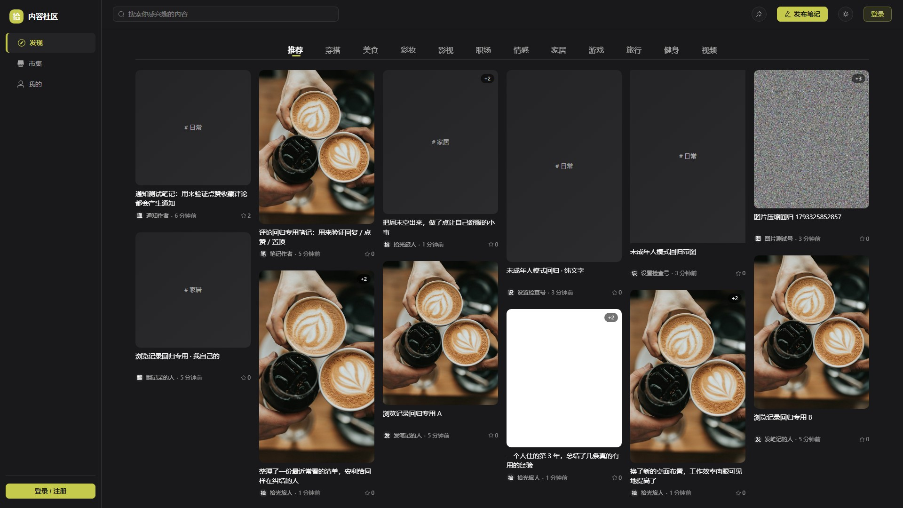

## ✨ 已实现功能

| 模块                                                                                                                                                    | 功能                                                                                                                                                                                                                                                                                                                                                                                                                                                                                                                                                                                                                                                                                                     |
| ------------------------------------------------------------------------------------------------------------------------------------------------------- | -------------------------------------------------------------------------------------------------------------------------------------------------------------------------------------------------------------------------------------------------------------------------------------------------------------------------------------------------------------------------------------------------------------------------------------------------------------------------------------------------------------------------------------------------------------------------------------------------------------------------------------------------------------------------------------------------------- |
| 账号                                                                                                                                                    | 注册 / 登录 / JWT 鉴权 / 自动登录态持久化 (Pinia + localStorage)                                                                                                                                                                                                                                                                                                                                                                                                                                                                                                                                                                                                                                         |
| 内容                                                                                                                                                    | 发布笔记 (文本 + 1~9 张图，带逐图上传进度条) / 真瀑布流 feed / 笔记详情 / 图片灯箱预览                                                                                                                                                                                                                                                                                                                                                                                                                                                                                                                                                                                                                   |
| 图片处理                                                                                                                                                | **上传前用 canvas 重编码**：长边封顶 2000px、JPEG/WebP 质量 0.82，一张 7.4MB 的手机照压到 1.5MB（-80%）；EXIF orientation 在上传前摆正，手机竖拍的照片不会歪着。原来的「单张 ≤10MB」卡错了东西 —— 用户要的是清晰度不是字节数，最坏情况一篇笔记 9×10MB = 90MB。**串行处理**（12MP 图 RGBA 约 48MB，9 张并发约 432MB 会让移动端解码直接崩）、**降级阶梯**（`toBlob` 在 iOS 面积超限时返回 null 而不是抛异常）、**任何失败都退回原图直传**（压缩失败对用户等价于发不出笔记）；解码走 `createImageBitmap`（浏览器在后台线程解码），只有 draw + `toBlob` 在主线程，每张处理完立刻把 canvas 尺寸置 0 归还位数据                                                                                                |
| 推荐流                                                                                                                                                  | **首页「推荐」频道是个性化排序，不是时间倒序**：分数 = 兴趣匹配 + 作者匹配 + 新鲜度（48h 半衰期）+ 热度（log 压缩防爆款霸屏）+ 关注加成 − 自推惩罚。画像从点赞/收藏/评论/关注/浏览**实时算**（30 天半衰期，收藏 3 > 评论 2 > 关注 1.5 > 点赞 1 > 浏览 0.2）；每条带**推荐理由**（「你常看「美食」」「你关注了这位作者」），hover 卡片有**不感兴趣**，兴趣画像页能看到权重条并**撤销屏蔽**。**排序冻结成快照**再翻页 —— 动态排序下 offset 分页必然同时漏一条重一条，游标也会漂；快照落在 `feed_sessions` / `feed_session_items` 两张表里、带过期时间，会话头和条目同一事务写入（不会有孤儿条目或空会话），过期清理也是一个事务 —— 所以进程重启不丢、多实例读的是同一份                                    |
| 搜索                                                                                                                                                    | 顶栏输入即出「笔记 / 话题 / 用户」三类候选 + 热门话题占位 + ↑↓/Enter/Esc 键盘导航；结果页支持三路匹配、最新·最多点赞·最多评论排序、命中高亮、搜索历史（去重置顶 / 单删 / 清空）                                                                                                                                                                                                                                                                                                                                                                                                                                                                                                                          |
| 关注                                                                                                                                                    | 关注 / 取关（幂等）+ 粉丝与关注列表（分页，每行自带 isFollowing）+ 互相关注标记 + 推荐关注（排除自己和已关注的人，按「有多少人关注ta」排影响力）+ 关注流（只含订阅内容，与推荐流分入口）                                                                                                                                                                                                                                                                                                                                                                                                                                                                                                                 |
| 收藏                                                                                                                                                    | 收藏 / 取消收藏（幂等）+ **多收藏夹**（建 / 改名 / 删；删夹不删内容，只退回未分类）+ 未分类显式可见 + 批量移入夹（整批一个事务）+ 主页「收藏」tab 按夹筛选；收藏是私密的，他人主页只显示私密占位                                                                                                                                                                                                                                                                                                                                                                                                                                                                                                         |
| 互动                                                                                                                                                    | 点赞 (可选登录态) / 收藏 (登录态) / 评论列表 + **评论增强**：二级回复（只支持两级，跨笔记回复会被拒）+ 评论点赞 + **作者置顶**（只有笔记作者能置顶自己写的评论 —— 规则本身保证一条笔记最多一条置顶，不需要唯一约束）+ 置顶标记 + 回复默认展开可收起                                                                                                                                                                                                                                                                                                                                                                                                                                                      |
| 评论排序                                                                                                                                                | 后端 `ORDER BY (pinned_at IS NOT NULL) DESC, pinned_at DESC, created_at ASC`；前端 `sortComments` 保持同一条规则 —— 两边不一致的话，用户点一下置顶、刷新一下顺序就变了                                                                                                                                                                                                                                                                                                                                                                                                                                                                                                                                   |
| 浏览记录                                                                                                                                                | 进详情页自动记一笔（**fire-and-forget，失败不打扰用户**）；重复看同一篇不产生第二条而是顶到最前；**限长 200 条在写入时顺手剪掉超出部分**（表里的量始终有界，不是读取时截断）；`viewed_at` 用**毫秒**而不是默认的秒级 —— 连续点开两篇会落在同一秒，而"保留最新 N 条"必须能分出先后，同一秒排序不确定就变成随机删几条；只给「清空」不给「删某一条」，因为用户对这个功能的真实诉求几乎总是"我不想让别人看到我都看了什么"                                                                                                                                                                                                                                                                                    |
| 个人主页                                                                                                                                                | 封面 banner / 头像 / 三栏统计 / 4 个 tab + 公开/私密/合集筛选 / ElDialog 编辑资料 / 推荐关注；「常用功能」里**没有假按钮** —— 曾经「发布新笔记」点了提示"即将上线"，而发布流程早就做完了                                                                                                                                                                                                                                                                                                                                                                                                                                                                                                                 |
| 话题                                                                                                                                                    | `/topic/:tag` 话题页：封面 + 笔记数 + 参与人数 + 相关话题（按「同话题作者的其它话题」推）+ 瀑布流；**不建 topics 表**，话题是 `posts.topic_tag` 的现算聚合视图，零维护、不可能有空壳话题；话题精确匹配（搜索联想才模糊）；三处入口全通：笔记详情标签 / 搜索建议 / 发布页热门话题一键填                                                                                                                                                                                                                                                                                                                                                                                                                   |
| 通知                                                                                                                                                    | 五个来源（赞 / 收藏 / 关注 / 评论 / @提及）落一张可回溯的流水；**同一组合只保留一条**（重复互动浮到顶部并重新点亮，而不是刷屏）；未读数靠 **WS 帧实时更新**（别人点赞的那一刻铃铛就 +1，不用轮询）；三个分类可分别「全部已读」+ **按分类的通知开关**（关掉只影响之后的新通知，历史不删）；笔记被删后通知仍在，显示「原笔记已删除」                                                                                                                                                                                                                                                                                                                                                                       |
| AI 问答                                                                                                                                                 | 顶栏入口 →「想了解些什么」+ 两组快捷问题 → 对话页**流式**吐答案，**每条结论挂着可点回原帖的来源**（笔记 / 话题 / 用户三类分开成 tab）；答案只来自站内真实笔记，**找不到就明说没有**；**不接模型 API**（无 key、离线可跑、CI 里确定），靠检索 + 证据组织                                                                                                                                                                                                                                                                                                                                                                                                                                                  |
| 消息                                                                                                                                                    | 两个顶层 Tab：通知（真实后端，见上一行）+ **实时聊天**（WebSocket 1v1：会话列表 / 历史分页 / 未读红点 / 已读回执 / 正在输入 / 多端同步 / 断线重连补发）；**撤回**（2 分钟内，只能撤自己的，内容**真的清空**并广播给双方）/ **置顶 + 免打扰**（每个人独立，置顶排最前）/ 消息流按抖音那套排：时间分隔线 / 未读分界线 / 同人连续消息合并 / **往上翻历史时不被新消息打断**（右下角出「N 条新消息」，自己决定要不要回到底部）；顶栏铃铛显示**聊天 + 通知**的合并未读                                                                                                                                                                                                                                         |
| 市集                                                                                                                                                    | 完整 C2C 交易链路：商品橱窗（**43 件真实商品** / 6 个分类 / 搜索 / 三种排序 / 翻页 / **发布商品**）/ 商品详情（**卖家视角**改价改库存上下架，买家视角加购直购）/ **我的商品**（卖家管理自己全部商品，**含下架的**）/ **购物车按卖家分组**结算 / **站内余额支付**（真的条件扣减 + 账本流水）/ 订单（我买的我卖的两个 tab，付款发货收货退款）/ 钱包（余额 + 可核对的流水 + 充值）。金额**全程整数分**，订单行是快照，库存用条件 UPDATE 防超卖，钱包有 `CHECK (balance >= 0)` 兜底；下单 / 付款 / 发货 / 收货 / 退款**每一步都在一个事务里**（订单、订单行、扣库存、清购物车同生共死），付款用 `WHERE status = 'pending'` 做乐观并发 —— 两个请求同时打过来只有一个改得动，另一个拿到 0 行变更而不是重复扣款 |
| 支付                                                                                                                                                    | 站内余额支付（真实现），微信 / 支付宝**置灰标注「未接入」而不是假装能点** —— 做成可点的话点了只能弹一句「模拟成功」，那比没有更糟。结算框里会列出三种方式和各自状态，让讨论有落点                                                                                                                                                                                                                                                                                                                                                                                                                                                                                                                        |
| 交易规则                                                                                                                                                | 一笔订单只能一个卖家的商品（闲鱼式 C2C 约束，发货权限因此天然清晰）；加购**不占库存**（那是预留问题，需要超时释放），下单才占用；                                                                                                                                                                                                                                                                                                                                                                                                                                                                                                                                                                        |
| **待付款订单 30 分钟没付就自动取消、库存退回**（库存是下单时扣的，不设时限的话，                                                                        |
| 买家不付款那件货就**被一直占着**，卖家只看到「库存 0」却不知道被谁占的）；                                                                              |
| 改数量传**绝对值**（传增量的话请求重试一次就多买一件）；PATCH 改不存在的商品 → 404，DELETE 不存在的 → 200（"改成 N"需要知道失败，"确保它不在"应当幂等） |
| 资金流                                                                                                                                                  | **在途资金**：买家付款 → 钱进平台在途（不是直接给卖家）→ 买家确认收货 → 结算给卖家；退款则是「在途 → 买家」原路退回。**守恒律：所有钱包余额 + 在途余额 == 充值总额**，钱包页和 `GET /api/wallet/audit` 都能当场查。少了在途这一层，退款就得从卖家账里扣，而卖家可能已经把它花掉了；加余额和写流水在同一个事务里 —— 只加钱不写流水账本就对不上，反过来余额没加而流水记了更糟                                                                                                                                                                                                                                                                                                                              |
| 布局                                                                                                                                                    | 桌面三栏：左侧固定 ElMenu（发现 / 发布 / 市集 / 我的 / 设置）+ 顶部栏（搜索 / 发布 / 主题 / 消息铃铛 / 用户菜单）+ 内容区；登录页走独立全屏                                                                                                                                                                                                                                                                                                                                                                                                                                                                                                                                                              |
| 首页频道                                                                                                                                                | 12 个内容频道用 ElTabs 平铺一行（推荐 / 穿搭 / 美食 / 彩妆 / 影视 / 职场 / 情感 / 家居 / 游戏 / 旅行 / 健身 / 视频），选中态为居中的强调色短条（`--el-color-primary` → `--accent`，暗色 `#c6ca4c` / 浅色 `#5f6417`）                                                                                                                                                                                                                                                                                                                                                                                                                                                                                     |
| 设置                                                                                                                                                    | 6 组卡片 + **11 个真面板**（账号与安全 / 切换账号 / 通用 / 通知 / 多语言 / 隐私 / 存储 / 收货地址 / 小组件 / 帮助 / 关于）+ 深色模式开关 + 账号摘要 + 退出登录。每个面板背后都有**真的接口或真实内容** —— 零「即将上线」式占位                                                                                                                                                                                                                                                                                                                                                                                                                                                                           |
| 动效                                                                                                                                                    | 五档时长 + 缓动字典 + CSS 原生弹簧（`linear()`，不需要动画库）；按语义分向入场（自己发的从右下、对方发的从左滑）；未读红点 pop / 铃铛来信摆一下；全局 `prefers-reduced-motion` 兜底，键盘用户有 `:focus-visible` 焦点环                                                                                                                                                                                                                                                                                                                                                                                                                                                                                  |
| 主题                                                                                                                                                    | 暗色 / 亮色切换（`html.dark` 驱动，Element Plus 变量同步切换 + localStorage 持久化）                                                                                                                                                                                                                                                                                                                                                                                                                                                                                                                                                                                                                     |

> 路线图见 [docs/architecture.md](docs/architecture.md#路线图)

## 📸 界面预览

首页见上方。全部为真实运行截图，由 `npm run screenshot` 生成
（脚本会自建临时账号造数据，跑完可一键清理）。

> **配图不会悄悄过期**：`docs/screenshots/manifest.json` 记着拍摄时的界面代码哈希，
> `npm run lint` 里有一道检查 —— 界面代码改过而图没重拍，它会直接让 CI 红。
> 以前没有这道防线，实测仓库里 33 张配图**每一张**都落后于界面代码
> （少的落后 39 次改动，多的 57 次），而「我的商品」页是 10-22 才加的功能，
> **一张图都没有**。

### 搜索：顶栏即时建议 → 结果页

| 搜索建议下拉                                             | 搜索页                                     |
| -------------------------------------------------------- | ------------------------------------------ |
| 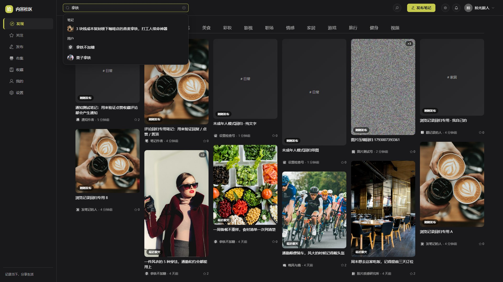 |  |

### 登录 / 注册

| 登录 / 注册                            | 首页（登录态：顶栏出现用户菜单）                       |
| -------------------------------------- | ------------------------------------------------------ |
| 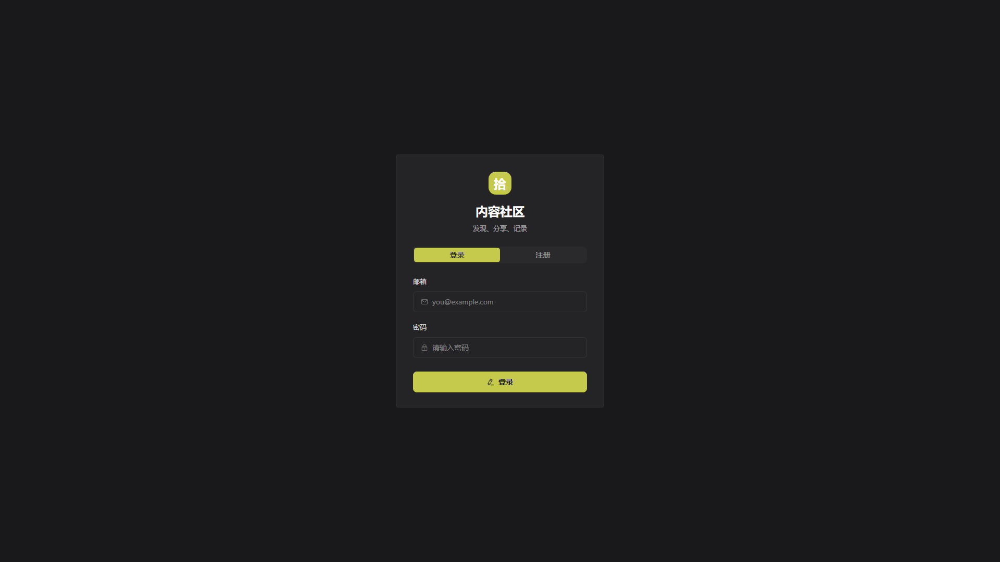 | 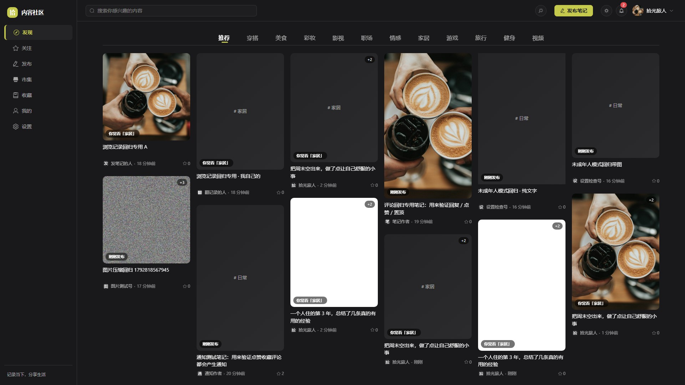 |

### 笔记详情 / 发布 / 个人主页

| 笔记详情                                     | 发布页                                     | 个人主页                                      |
| -------------------------------------------- | ------------------------------------------ | --------------------------------------------- |
| 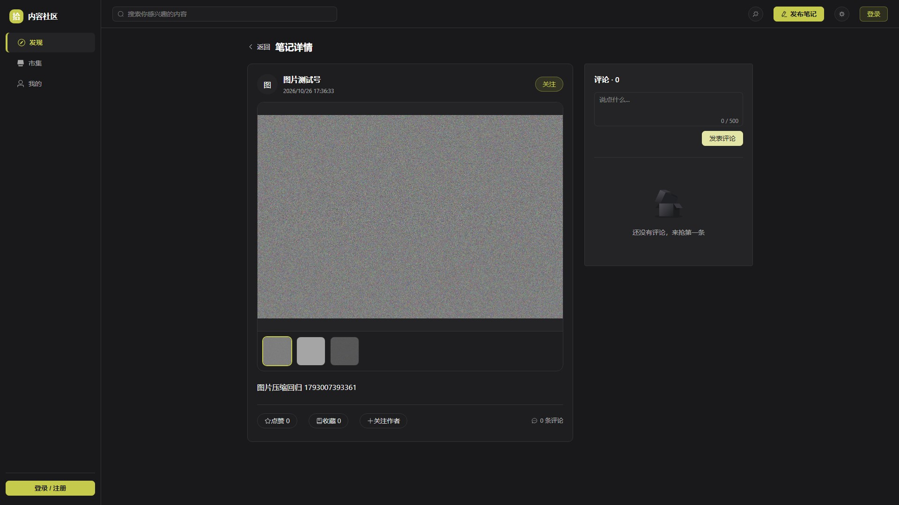 | 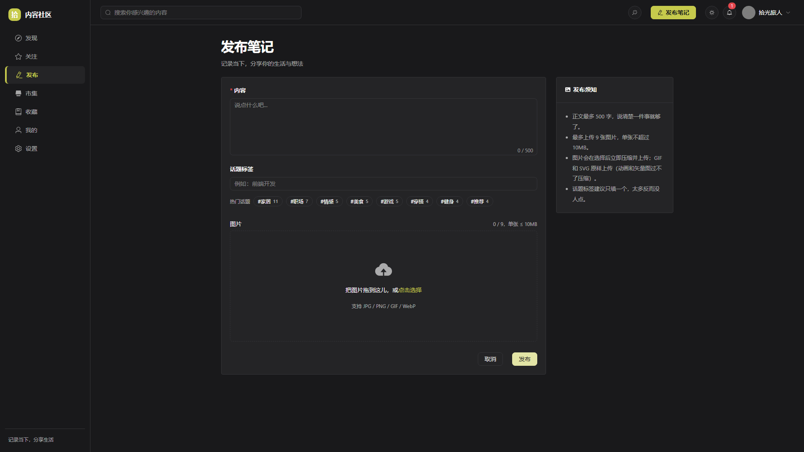 | 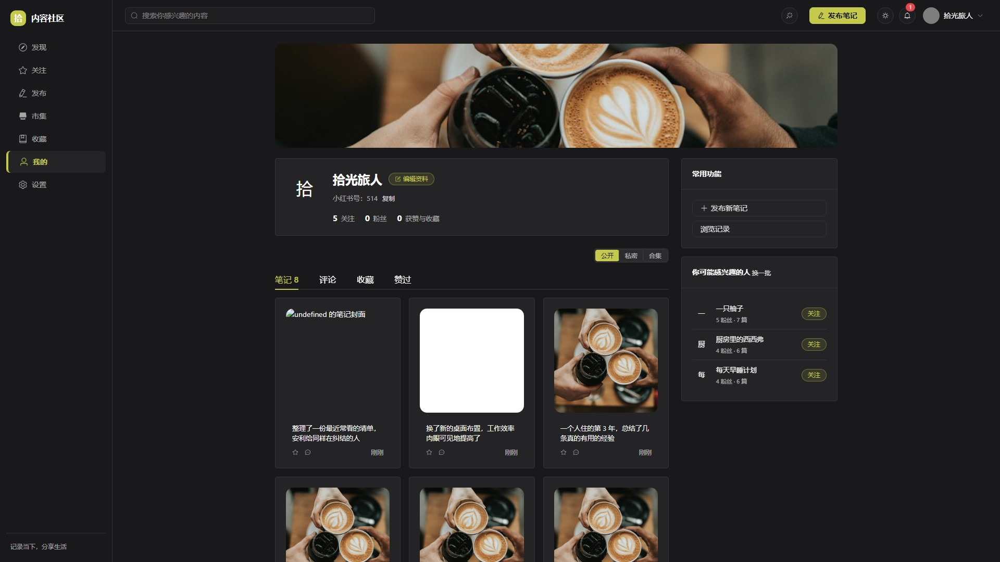 |

### 市集：橱窗 → 商品 → 购物车 → 订单 → 钱包

这六张是**有交易状态**的页面，配图脚本会先发布商品、下单、支付、发货再截 ——
空态证明不了「这个功能完成了」。

| 橱窗                                         | 商品详情                                            | 购物车                                         |
| -------------------------------------------- | --------------------------------------------------- | ---------------------------------------------- |
| 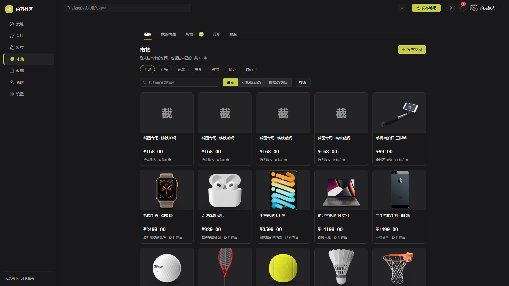 | 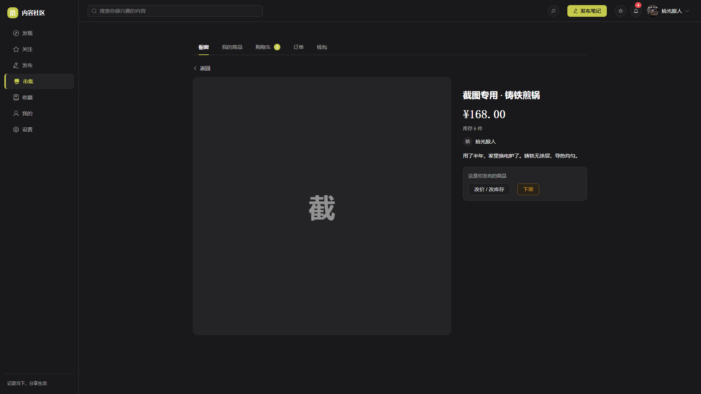 | 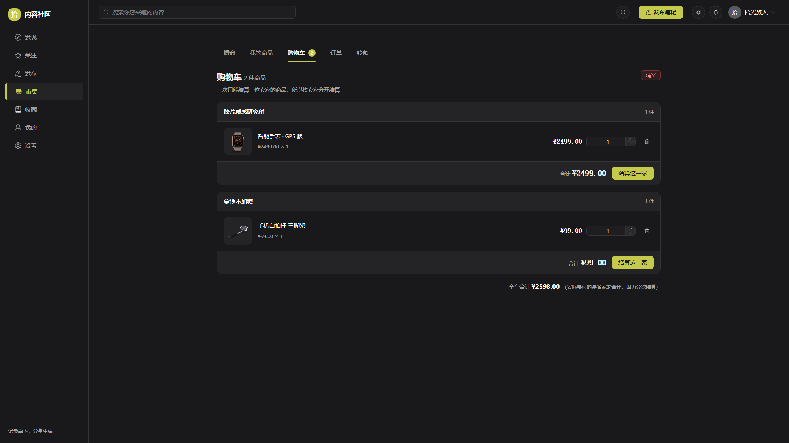 |

| 订单                                           | 钱包（含全局对账）                             |
| ---------------------------------------------- | ---------------------------------------------- |
| 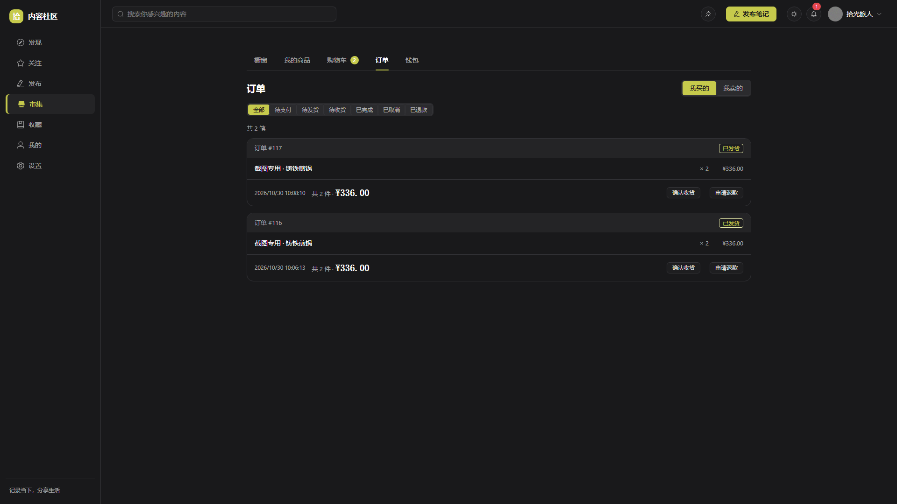 | 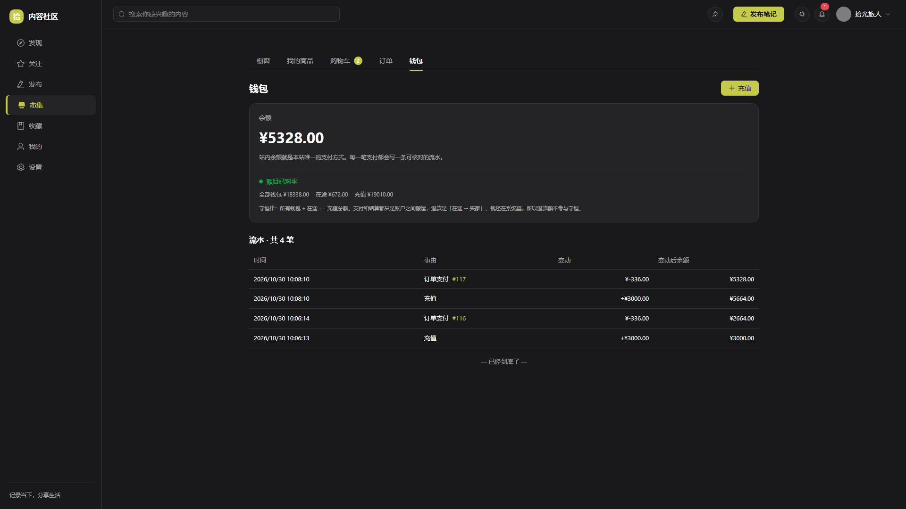 |

| 我的商品                                         |
| ------------------------------------------------ |
| 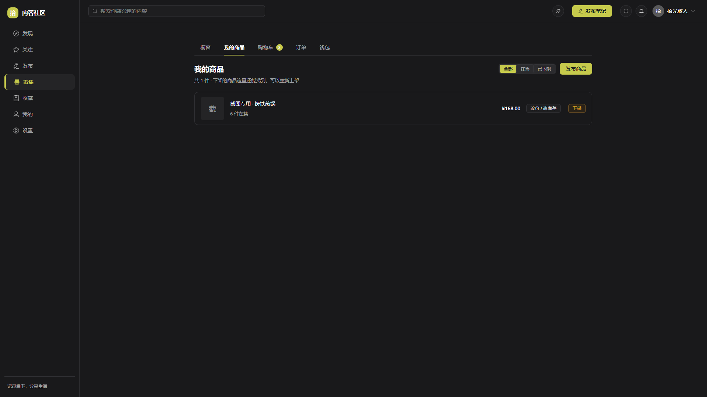 |

> 购物车那张特意放了两位卖家的商品：**一笔订单只能一个卖家**，所以必须按卖家分块、
> 每块一个结算按钮。钱包那张底部的绿色对勾是全局守恒律的实时状态
> （所有钱包 + 在途 == 充值总额），它不是装饰，是真的每次请求都在算。

> **橱窗里那 43 件商品是爬来的，不是手写的。**
> `scripts/fetch-market-data.mjs` 从 dummyjson 的公开演示商品 API 拉真实商品图和价格分布，
> 图片本地落盘（不热链 CDN），中文名和描述按抓到的信息人工校准 ——
> 保证**图 ↔ 标题 ↔ 分类**三者对得上。
>
> 之前那 11 件是手写的，而配图是从**笔记**的图里按序号凑的，
> 于是写着「五常大米」的商品可能挂着一张显卡的图 ——
> 那比没有图更糟，一眼就是假数据。
>
> **下架的商品曾经找不回来**，这个洞已经堵上：橱窗只显示在售的，
> 所以卖家一旦下架，那件商品就没有任何界面能再找到它 —— 改不了价，也上不了架。
> 「我的商品」页传的是**自己的 id**，服务端对本人返回全部商品（含下架的），对别人只给在售。

### 推荐流：理由 + 纠正入口

| 推荐流（首卡 hover 出「不感兴趣」）                | 我的兴趣画像                                   |
| -------------------------------------------------- | ---------------------------------------------- |
| 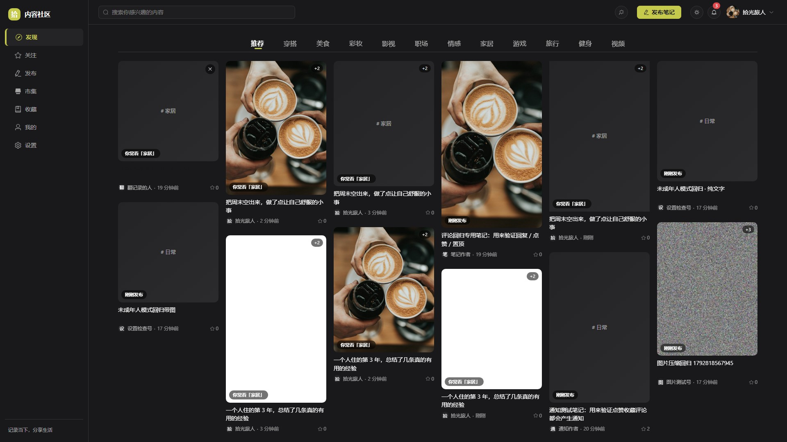 | 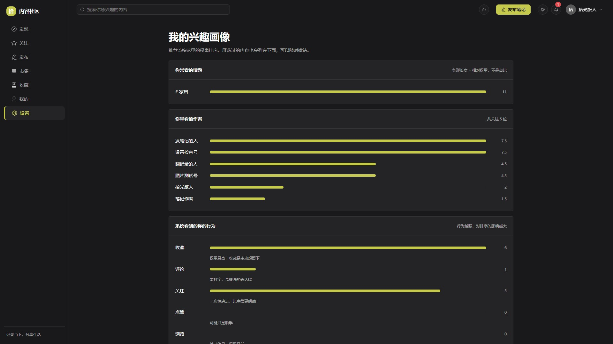 |

> 推荐流那张每张卡片左下角都写着**它为什么出现** —— 你常看「穿搭」 / 你关注了这位作者 /
> 刚刚发布，四种理由在首屏里交错出现。这不是装饰：理由是让推荐**可纠正**的前提，
> 用户纠不了，负反馈就收不上来，整个系统会变成一个只会越来越窄的黑盒。
>
> 所以推荐流上还有 hover 才显形的「不感兴趣」，和右边那张画像页 ——
> 权重条看得见、行为信号看得见、**屏蔽过什么也看得见并且可以撤销**。
> 截图脚本特意先制造一条负反馈，否则这一栏会是空的，而空态证明不了「可撤销」。

### 发布页：上传前自动压缩

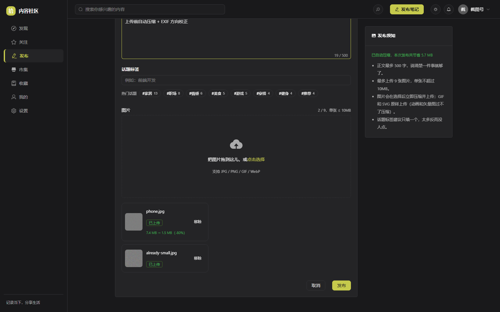

> 左边 `phone.jpg` 是 7.4MB 压到 1.5MB（-80%），右边 `already-small.jpg`
> **没有**收益文案 —— 重编码不保证变小，够小的图走一趟 canvas 纯属白干还变胖，
> 所以它直接放行。右栏那句「本次发布共节省 5.7 MB」是真实的合计值。
>
> 顺带把 EXIF orientation 摆正了：手机竖拍的照片在某些环境下会歪着显示，
> 而用户分不清是自己拍歪了还是网站坏了。这里是把 APP1 段**物理删掉再解码**，
> 不是依赖 `createImageBitmap` 的 `imageOrientation` 选项 —— 详见下面的
> 「EXIF 朝向」一行。

### 滚动入场：错峰 / 完成 / 降低动效

| 错峰进行中                                      | 完成态                                       | 降低动效                                            |
| ----------------------------------------------- | -------------------------------------------- | --------------------------------------------------- |
| 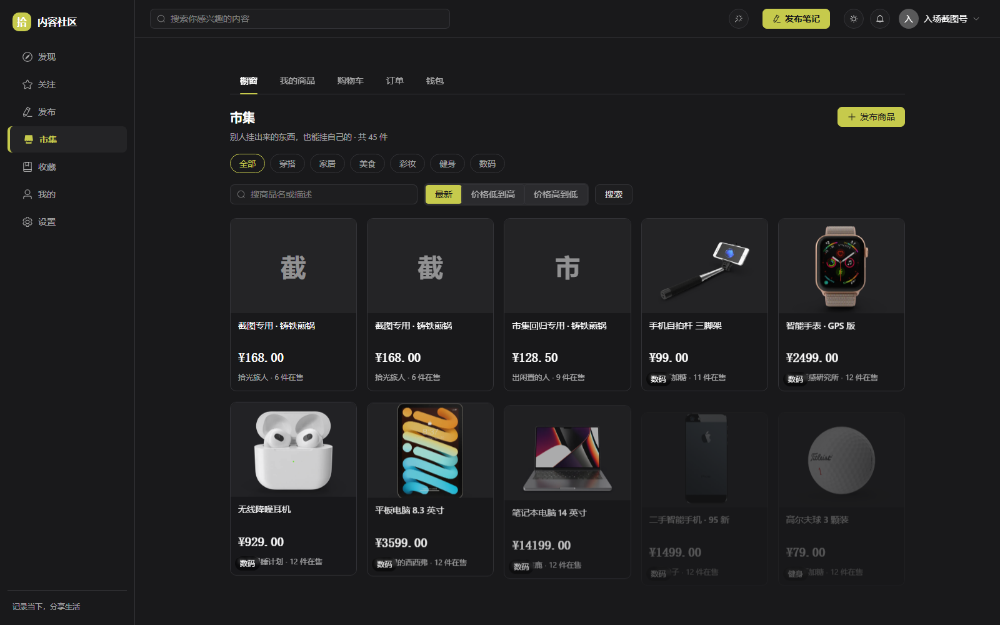 |  | 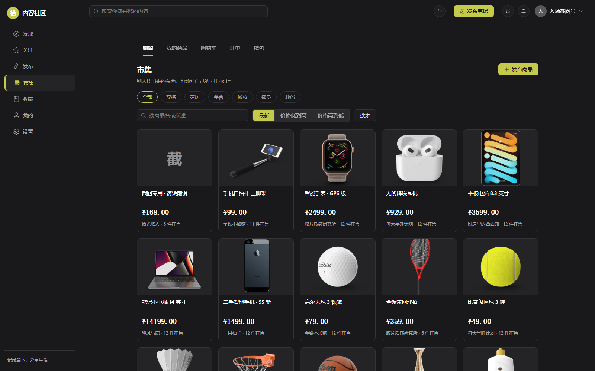 |

> 左边截在动画中途：delay 为 0 的第一张卡已经亮起，最后几张还在暗处，
> 一屏十几件商品是**依次浮现**而不是「啪」地一起出现。
> 右边是完成态，第三张是系统开启「减少动态效果」时的样子。
>
> 这套效果借鉴自 [Endfield Charge Plus 官网](https://zmd-bar.x-neko.com/) 的滚动入场，
> 但**没有照搬**：位移从源站的 35px 降到 24px（源站动的是整段大标题，
> 本项目的卡片才 200px 高），错峰步长按列表形态分档（瀑布流 60ms / 规整网格 45ms）。
>
> **第三张和第二张做过逐像素比对**，而且这个比对现在是**每次重拍都会跑**的断言
> （`scripts/reveal-shot.mjs`），e2e 里也有一份（`scripts/reveal-smoke.mjs`）。
> 降低动效之后，页面终态必须和正常完成态一致。
>
> 这个断言抓出过一处真问题：正常路径的终点写的是 `transform: translateY(0)`，
> 视觉上和 `none` 等价，但会**留一个合成层** —— 层里的图片被重采样、
> 文字从次像素抗锯齿退化成灰度抗锯齿。
> 实测 1600×1000 的视口里 **1.14% 的像素有可见差异**（最大通道差 688），
> 也就是说两张图**肉眼能看出不是同一张**。改成 `none` 之后降到 **0.004%**（差 284 倍），
> 而且那批合成层也一起释放了 —— 一屏几十张卡各占一层，GPU 显存本来就在白花。
>
> 断言本身也被自己的断言修过一次：它一开始报「降级 vs 正常差 3.98%」，
> 而 e2e 里的 DOM 断言（transform 必须是 `none`、opacity 必须是 1）指出
> **是测试自己没等够** —— 原来等的是「class 加上了」，
> 而 class 一加上就开始过渡（delay 最多 360ms **加**时长），
> 截图拍到的是动画中途。改成等**计算样式到位**之后，差值从 3.98% 降到 0.004%。
>
> 判据是**像素数量**而不是字节数 —— 字节数受 PNG 编码器参数影响，
> 变了不代表画面变了；门槛也不是拍脑袋定的，
> 是拿「同参数连拍两次」的渲染噪声当基准（实测 0.000%~0.007%），
> 再要求「降级 vs 正常」不得大幅超过它。
> 之前 README 里写的是「两张图字节数完全相同」—— 那句话**是错的**
> （实际差 19 字节），而且它用的证据也不可靠。

### 消息与设置

| 消息中心                                      | 设置                                      |
| --------------------------------------------- | ----------------------------------------- |
| 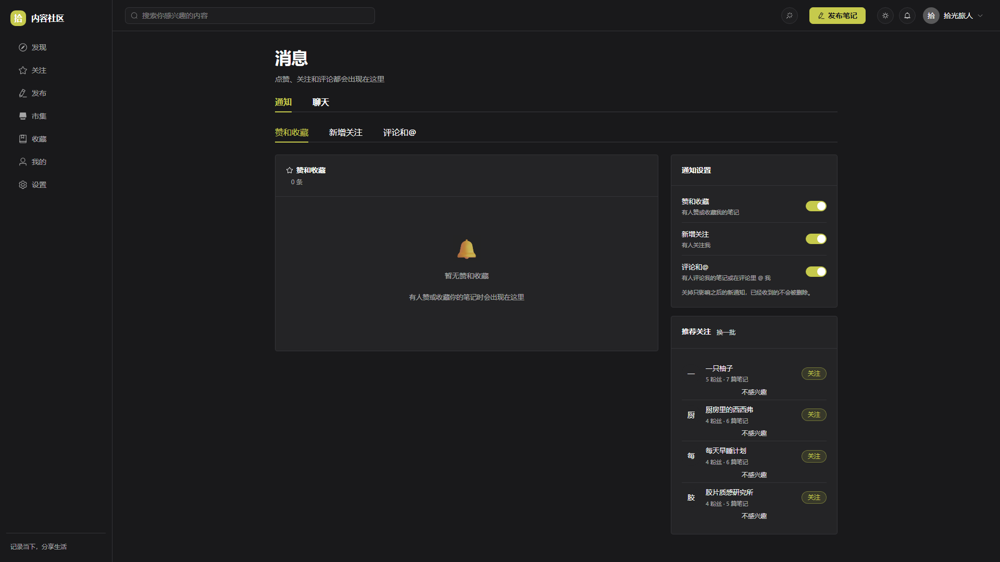 | 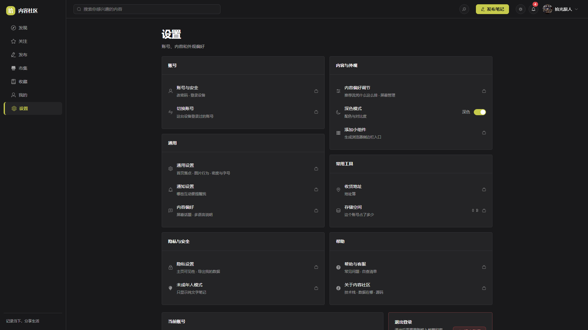 |

### 设置页：零假按钮

| 设置首页                                  | 面板示例（收货地址）                            |
| ----------------------------------------- | ----------------------------------------------- |
| 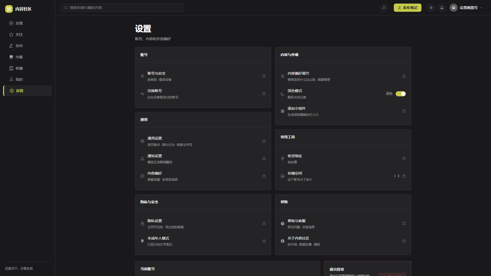 | 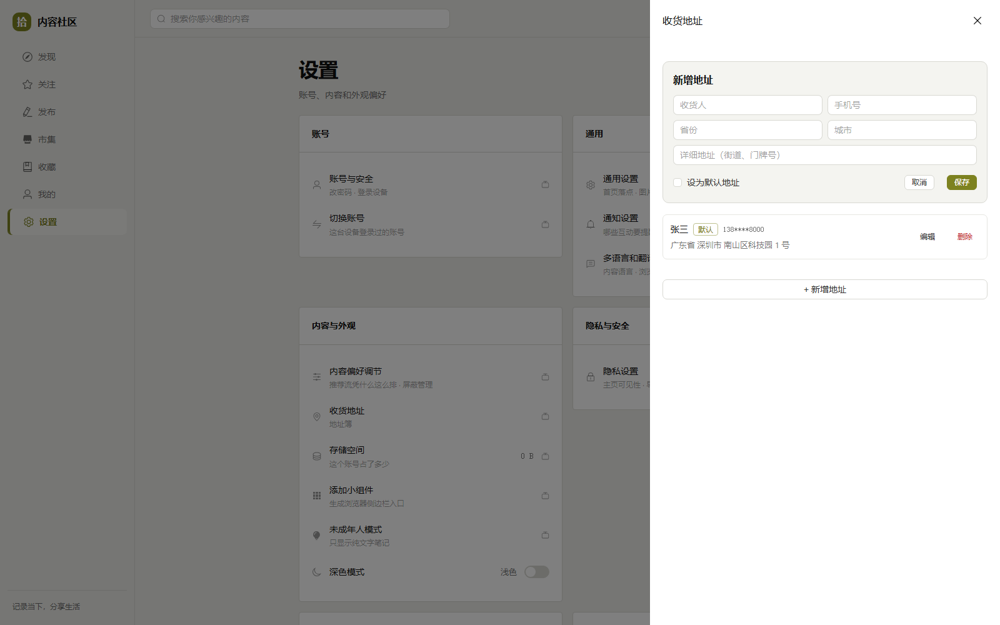 |

> 之前这页上有 13 个「点了只会弹一句『即将上线』」的按钮。
> 现在每一行都写清了背后是什么（「改密码 · 登录设备」、
> 「推荐流凭什么这么排 · 屏蔽管理」），点开都有真实内容。
>
> 「存储空间」右边那个 **0 B** 也是真的 —— 它逐个去磁盘上量文件大小。
> 原来的版本写死是「1.94 GB」，一个凭空捏造的数字比没有更糟：
> 用户会拿它做判断，而它永远不变。

### 关系与内容：关注 / 收藏 / 话题 / 评论

这四张是「内容有了才好看」的页面，所以配图脚本会先造关注边、收藏夹和评论线程再截 —— 截空态证明不了任何完成度。

| 收藏夹管理                                    | 话题页                                    |
| --------------------------------------------- | ----------------------------------------- |
| 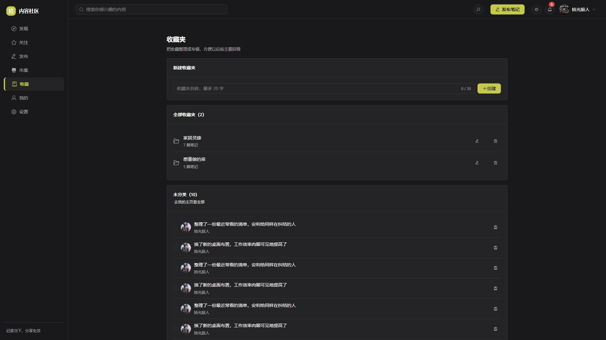 | 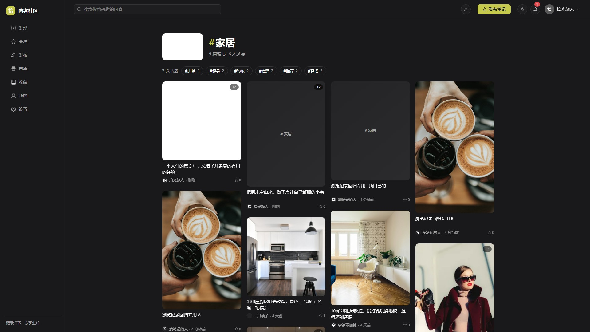 |

| 关注列表                                      | 评论区                                              |
| --------------------------------------------- | --------------------------------------------------- |
| 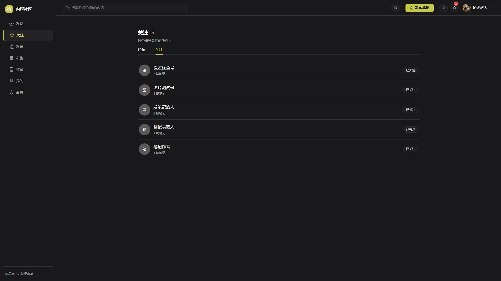 | 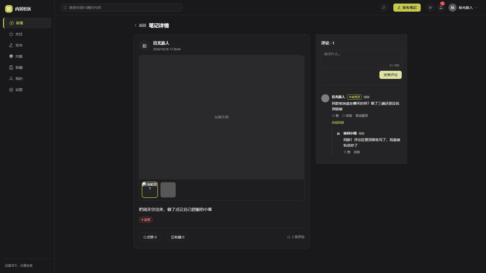 |

## 🛠 技术栈

**前端** ([client/](client/))

- Vue 3.5 (Composition API + `<script setup>`)
- TypeScript 5.6
- Vite 6 (含 `/uploads` 反代解决 dev 跨域)
- **Element Plus 2.14** + `@element-plus/icons-vue`，通过 `unplugin-vue-components` 按需自动引入
- Pinia 4 + `pinia-plugin-persistedstate` (auth 持久化)
- Vue Router 4
- Axios 1 (formdata 走原生 XHR 绕开 multipart bug)

**后端** ([server/](server/))

- Node.js + Express 5
- better-sqlite3 (同步 SQLite，本地文件)
- bcryptjs (密码哈希)
- jsonwebtoken (JWT 鉴权)
- multer (multipart/form-data 上传，diskStorage)

## 🚀 快速开始（Docker）

```bash
docker compose up --build -d                       # 起前后端，浏览器开 http://localhost:8080
docker compose --profile seed run --rm seed        # 可选：灌 39 条中文演示笔记 + 6 个用户
docker compose logs -f server                      # 看日志
docker compose down                                 # 停掉（数据留在 .docker-data/，不会被删）
```

结构刻意和真实部署一致：

```
浏览器 ──8080──▶ web（nginx）
                  ├── /            → 静态产物（SPA fallback）
                  ├── /assets/     → 带 hash，长缓存
                  ├── /api/*       → 反代 server:3000
                  ├── /uploads/*   → 反代 server:3000（图片存在后端）
                  └── /ws          → 反代 + Upgrade 头（WebSocket）
                                    后端只 expose 在容器网络内，不对宿主机开端口
```

几个值得一看的细节：

- **多阶段构建**：后端镜像只在构建阶段装 `python3/make/g++`（`better-sqlite3` 编译原生模块用），运行时阶段 `npm prune --omit=dev` 删掉 devDeps，工具链不进最终镜像
- **`CMD ["node", "dist/index.js"]` 而不是 `npm start`**：npm 会多起一层进程转发信号，结果后端的优雅退出钩子（先关 WS 连接再关 HTTP）收不到 `SIGTERM`，只能等超时被强杀
- **SQLite 挂载**：`better-sqlite3` 存的是单个文件，而 Docker 的 named volume 只能挂目录，所以 `DB_PATH` 单独暴露成一个环境变量，compose 里挂目录再指进去（默认路径不变，本地开发无感）
- **`VITE_API_BASE` 在构建期注入**：vite 会把 `import.meta.env.VITE_*` 静态替换进 bundle，运行时再设环境变量没用。容器里前后端同源，用相对路径 `/api`，产物里不含任何 `localhost:3000` 硬编码
- **健康检查 + `depends_on: service_healthy`**：等后端真的能连上 SQLite 再起 nginx，否则首页首屏会是空的，看着像 bug

> 需要 Docker Desktop（Windows 上依赖 WSL2）。想手动换端口：`WEB_PORT=9090 docker compose up`。

## 🛠 本地开发

```bash
# 1. 启动后端（:3000）
cd server
npm install
cp .env.example .env
npm run dev          # tsx watch src/index.ts

# 2. 启动前端（:5173）
cd client
npm install
npm run dev          # vite
```

打开 http://localhost:5173/ 注册账号即可使用。图片会上传到 `server/uploads/`，前端 `/uploads/*` 通过 `server.proxy` 反代到 3000（生产 nginx 同源直出）。

想在本地灌演示数据：`npm run seed`（根目录执行）。配图需要先 `npm run seed:photos` 下载。

### 测试

```bash
npm run test:client          # 前端单测（vitest + @vue/test-utils，37 文件 554 条）
npm run test:client -- coverage   # 同上 + 覆盖率报告（utils / composables / components，语句 87%）
cd server && npm test        # 后端单测（vitest + supertest，26 文件 508 条）
cd server && npm run test:coverage   # 同上 + 覆盖率报告（src 全部，语句 78%）

npm run test:e2e             # Playwright 桌面端全流程回归（登录态，55 断言）
npm run test:search          # 搜索功能 + 注入防护（31 断言）
npm run test:center          # 1920 宽屏下逐页检查左右留白是否居中
npm run test:chat            # 即时通信：多端同步 / 已读回执 / 断线重连补发（开两个浏览器上下文，20 断言）
npm run test:follow          # 关注体系：按钮翻转 / 计数 / 粉丝列表方向 / 关注流 / 侧栏高亮（27 断言）
npm run test:favorite        # 收藏与收藏夹：建夹 / 批量移入 / 删夹退回未分类 / 他人主页私密（34 断言）
npm run test:notify          # 通知中心：双浏览器验证 WS 实时铃铛 / 去重 / 不通知自己 / 通知开关 / 已读持久化（25 断言）
npm run test:topic           # 话题页：三处入口是否都通 / 精确匹配语义 / 404 空态不打错（27 断言）
npm run test:comment         # 评论增强：两级回复 / 点赞持久化 / 置顶权限与排序（32 断言，双上下文）
npm run test:history        # 浏览记录：进详情页自动记一笔 / 重复看不重复 / 游客不记 / 清空（19 断言）
npm run test:market         # 市集：发布 → 加购 → 下架 → 下单 → 支付 → 发货 → 收货 → 退款 → 全局对账（54 断言，双上下文）
npm run test:feed           # 推荐流：理由 / 不感兴趣 / 刷新后仍屏蔽 / 换一批 / 画像页撤销（26 断言）
npm run test:reveal         # 滚动入场：逐帧证明动效在推进 / reduced-motion 真的停 / 没有 IntersectionObserver 不白屏 / 降级终态和正常终态逐像素一致（21 断言）
npm run test:settings       # 设置页：逐个点 13 项验证零静默 / 11 个面板有内容 / 存储显示真实统计值 / 偏好真落库（22 断言）
npm run test:image          # 图片压缩：真 canvas 真的压下去 / EXIF 摆正后宽高交换 / 照片型 PNG 落盘是 WebP（23 断言）
npm run test:motion          # 动效验证：证明入场真的在推进，且 reduced-motion 下真的停
npm run test:e2e:all         # 按 CI 的方式顺序跑完 15 套（每套日志落 .e2e-logs/，跑完汇总）
npm run screenshot           # 重新生成 docs/screenshots/ 下的 README 配图
```

> **上面这些条数是代码里的断言点，不是某次跑出来的次数。**
> 单测条数对 `npx vitest run` 的末尾汇总；
> e2e 条数数的是 `scripts/*-smoke-mjs` 里的 `check(` 调用点 ——
> 任何一个数字都能自己数出来复核，不用信作者。
> 之所以写死口径而不写「实跑次数」：套件里有循环（同一段断言跑多遍），
> 实跑次数随数据变，写进文档就是个会漂的数字。

**这套数字为什么曾经是错的**：README 里同一批断言数被手抄了两遍（测试章节 + 项目结构），
每加一条断言要改两处，漏一处就出现「同一个套件在两处写着不同条数」。
现在只留一处，另一处只写职责 —— **重复的数字一定会漂**。

> **性能与体积**：这三个脚本不是回归测试，是量数字的工具（都能复现下面的实测值）
>
> ```bash
> npm run perf               # 生产构建 + Slow 4G 限速首屏实测：FCP/LCP/CLS + 首屏流量构成
> npm run perf:bundle        # entry chunk 字节归因：vue / element-plus / axios / 业务代码各占多少
> npm run perf:bundle -- --why dayjs   # 打印「这个包为什么会进首屏」的最短依赖链
> npm run audit:images       # uploads 目录体检：每张图的像素尺寸与「字节/像素」
> npm run check:css          # 用 esbuild 当裁判扫全部 CSS（lint 里也会跑，CI 会拦）
> ```

> 前端单测不只测纯函数：WebSocket 状态机（握手语义 / 退避重连 / 4401 停止重试 / 心跳保活）、
> 聊天乐观发送（tempId → 真实 id 的乱序 ack 收敛）、顶栏未读红点与建议下拉键盘导航
> 都是挂载或真实驱动的。覆盖率门槛配在 `client/vitest.config.ts`（四项均 60%），跌破会让 CI 直接红。
>
> **可访问性**：
>
> ```bash
> npm run a11y                 # 静态扫描 + axe-core（WCAG 2.1 A/AA），37 个页面状态
> npm run a11y -- --static     # 只跑静态扫描，不用起服务
> npm run a11y -- --only 设置   # 只审设置页（含 11 个抽屉面板）
> npm run a11y -- --light      # 强制浅色模式再扫一遍
> ```
>
> 市集那一套特别值得看：`test:market` 走的是**完整生命周期**而不是"页面能打开"，
> 最后一步是**拿流水的 delta 求和去验余额**。退款如果只退库存不退钱，
> 前面所有断言都会绿，只有这一条会红 —— 而那正是它抓到过的真 bug。
>
> 推荐流的断言大部分是「**不该发生什么**」：换一批之后列表仍然完整、
> 刷新后被屏蔽的那篇不再出现、频道流里不出现推荐装饰。
> 这类反向断言比「页面上有 12 张卡片」值钱得多 —— 后者在推荐彻底坏掉时照样是绿的。

> `test:image` 必须单独一套：jsdom 里没有 `canvas.getContext` 也没有 `createImageBitmap`，
> 给它 mock 一个 canvas 也不行 —— 那测的是「我 mock 对了」，不是「压缩真能把 3000×2000 压下去」。
> 所以造图用**高频噪点**而不是纯色（纯色会被 JPEG 自己压到极小，
> 分不清是「我的压缩起作用了」还是「原图本来就小」），
> 最后一条断言是**落盘文件比原图小** —— 页面上那句「-80%」可以随便编，磁盘上的字节不会说谎。

> Playwright 脚本依赖 dev server 在跑；**刚重启 vite 时第一次跑会因为 Element Plus 依赖预构建未完成而假失败**（`el-*` 判不可见但零 console error），先 `curl localhost:5173` 触发预构建、等十几秒再跑即可。

## 📁 项目结构

```
content-sharing-platform/
├─ docker-compose.yml            # 一键起全栈：web(nginx) + server(+ seed profile)
├─ client/                       # Vue 3 + Vite 前端
│  ├─ src/
│  │  ├─ views/                  # 21 个页面组件 / 20 条路由（ChatView 嵌在 MessagesView 里，不单独占路由；AiChatView 是 AI 对话页）
│  │  │                          # Home / PostDetail / Publish / Profile / FollowList / Messages / Search / Settings / Favorites / Topic / Login / NotFound / Interest（兴趣画像）/ Market / ProductDetail / Cart / Orders / Wallet
│  │  ├─ components/             # SideNav（左侧导航）/ TopBar（顶部栏）/ PostMasonry（最短列优先瀑布流，首页与搜索页共用）/ MarketTabs（市集分区，购物车角标）/ EmptyState / ErrorBoundaryAiEntry（顶栏 AI 入口，同步）/ AiPanel（AI 展开面板，**懒加载**）/
│  │  ├─ assets/styles/          # theme.css（自有 design token） + element-theme.css（Element Plus 变量接管）+ motion.css（五档时长 / 缓动字典 / reduced-motion 兜底）
│  │  ├─ composables/            # useWebSocket（连接状态机 / 退避重连 / 心跳）/ useChat（乐观发送 + ack 收敛）
│  │  │                          # useNotifications（模块级单例 + WS 覆盖而非 +1）/ useFollow / useFavorite（乐观更新 + 失败回滚）
│  │  │                          # useTheme / useSearchHistory / useRelativeTime / useCart（市集共用购物车，模块级单例 + 按 sellerId 分组）
│  │  │                          # useFeed（推荐会话：游标翻页 + 本地去重 + 屏蔽先本地生效、失败回滚到原下标）
│  │  │                          # useReveal（滚动错峰入场：默认可见的降级顺序 + 档位封顶）
│  │  ├─ api/                    # request.ts（axios 实例 + 拦截器 + getOrNull）/ auth / posts（含点赞）/ uploads / ai（SSE 流式，**用原生 fetch 不走 axios**）
│  │  │                          # comments / follows / favorites / notifications / topics / conversations / wsProtocol（WS 协议的前端镜像）
│  │  │                          # 市集四个：products / cart / orders / wallet —— 与服务端 routes 一一对应，字段名照抄不改
│  │  │                          # feed（推荐流：sessionId + cursor 游标，注意和 posts/feed 的 offset 分页是两套东西）
│  │  ├─ utils/                  # masonry.ts（列数换算 / 高度估算 / 最短列优先分列 / 关键词切分）
│  │  │                          # comments.ts（sortComments / groupReplies —— 规则必须与后端 ORDER BY 一致）
│  │  │                          # money.ts（整数分 ↔ 元；元换分全程整数运算，不用浮点乘 100）
│  │  │                          # image.ts（纯函数层：尺寸换算 / mime 决策 / EXIF 字节解析 / 朝向变换，不碰 DOM）
│  │  │                          # imageCompress.ts（canvas 重编码 + 降级阶梯 + 串行处理；jsdom 里测不了，靠 e2e）
│  │  ├─ stores/                 # Pinia: auth / toast / homeTabs
│  │  ├─ router/                 # Vue Router 配置（20 条路由 + requiresAuth / guestOnly 守卫 + 路由懒加载）
│  │  └─ constants.ts            # 客户端常量（与 server mirror）
│  ├─ tests/                     # vitest + @vue/test-utils（jsdom，37 文件 554 条）
│  │  ├─ helpers/fake-socket.ts  # 可手动驱动的假 WebSocket
│  │  ├─ ai-chat-view.test.ts    # AI 对话页：来源先于答案 / 流式是追加不是替换 / 三类来源 tab
│  │  ├─ image.test.ts           # 图片纯函数（41 条；EXIF 字节流是手工拼的，好处是能把截断 / 伪造字节序 / 越界偏移写得很具体）
│  │  ├─ websocket-machine.test.ts  # 握手语义 / 退避重连 / 4401 / 心跳保活
│  │  ├─ use-chat.test.ts        # 乐观发送 / 乱序 ack 收敛 / 已读回执 / 游标分页
│  │  ├─ use-notifications.test.ts   # 模块级单例 / WS 覆盖而非 +1 / markRead 失败回滚
│  │  ├─ use-follow.test.ts      # 关注按钮状态翻转
│  │  ├─ use-favorite.test.ts    # 收藏 / 收藏夹（13 条）
│  │  ├─ top-bar.test.ts         # 未读红点 + 建议下拉键盘导航
│  │  ├─ login-view.test.ts      # 挂载登录页：redirect 必须挡掉 //evil.com（协议相对 URL）
│  │  ├─ home-view.test.ts       # 挂载首页：发现 ⇄ 关注 ⇄ 推荐流 三套数据源不能串味
│  │  ├─ messages-view.test.ts   # 挂载消息页：通知分类 / 落点 / 偏好开关的回滚
│  │  ├─ topic-view.test.ts      # 挂载话题页：404 与加载失败是两种东西 / 翻页去重
│  │  ├─ favorites-view.test.ts  # 挂载收藏夹：未分类是服务端筛选 / 删夹不删内容
│  │  ├─ follow-list-view.test.ts    # 挂载关注列表：粉丝关注方向不能反 / 空态四种
│  │  ├─ view-history-view.test.ts   # 挂载浏览记录：清空按钮的显隐 / 翻页去重
│  │  ├─ cart-view.test.ts       # 挂载购物车：按卖家分块 / 结算必须是两步（下单≠支付）/ 余额不够禁下单
│  │  ├─ market-view.test.ts     # 挂载橱窗：元↔分转换拒绝 12.345 / 翻页去重 / 发布失败不关表单
│  │  ├─ orders-view.test.ts     # 挂载订单：按钮集合直接对着 ORDER_ACTIONS 断言，而不是断言某个按钮出现了
│  │  ├─ use-cart.test.ts        # 按 sellerId 分组（昵称相同也必须分两组）/ isPayable 的防御性复查
│  │  ├─ money.test.ts           # 整数分 ↔ 元：0.29 → 29 不能是 28.999…（浮点乘 100 是坏的）
│  │  └─ masonry / post-masonry / search-history / comments-utils / websocket（纯函数层）
│  ├─ Dockerfile / nginx.conf    # 多阶段构建 + 静态托管与反代
│  ├─ components.d.ts            # unplugin-vue-components 生成的组件声明
│  ├─ vite.config.ts             # 按需引入插件 + /uploads 反代
│  └─ vitest.config.ts           # 前端单测配置（jsdom + @ 别名 + 覆盖率四项 84/75/81/85 门槛，与生产构建配置分开）
│
├─ server/                       # Express + SQLite 后端
│  ├─ src/
│  │  ├─ index.ts                # 入口，挂载中间件 + 路由 + WS + 优雅退出
│  │  ├─ ws/                     # protocol（帧类型）/ hub（Map<userId, Set<WebSocket>>）
│  │  │                          # instance（hub 单例，路由与 HTTP 侧共用）/ server（握手鉴权 / 心跳 / 路由）
│  │  ├─ lib/ai-retrieve.ts      # AI 检索层：切词 + 召回门槛 + 话题/作者聚合
│  │  ├─ lib/ai-answer.ts        # AI 生成层：证据组织（无 key 降级）/ 可选 LLM
│  │  ├─ lib/db.ts               # better-sqlite3 连接 + Proxy 注入（DB_PATH 可配，测试换 :memory:）
│  │  ├─ lib/schema.ts           # 全部 DDL + 幂等 ALTER 迁移（生产与每个测试文件共用同一份）
│  │  ├─ lib/notify.ts           # 写通知的唯一入口：不通知自己 / 同组合去重 / 按分类开关决定发不发
│  │  ├─ lib/mount-routes.ts     # mountApiRouters()：生产与测试挂同一份路由（避免"测试全 404 但文件绿"）
│  │  ├─ middleware/auth.ts      # JWT 校验 (requireAuth / optionalAuth)
│  │  ├─ routes/                 # auth / users / posts / likes / comments / favorites / notifications / topics / viewHistory / uploads / conversations / feed / ai（站内问答：SSE 流式 + 快捷问题）
│  │  │                          # 市集四条独立前缀：products / cart / orders / wallet（不和 /api/posts 混，涨跌互不影响）
│  │  │                          # 推荐流独占 /api/feed：GET / 翻页、POST+DELETE /feedback、GET /profile
│  │  │                          # 注意：关注的 5 个接口（follow / relation / followers / following / suggestions）挂在 users.ts 里，
│  │  │                          # 因为它们的主键都是 userId；客户端则单独拆成 api/follows.ts
│  │  ├─ lib/feed-score.ts       # 推荐打分，**纯函数不碰 DB**：热度 log 压缩 / 新鲜度半衰期 / 兴趣归一化 / 推荐理由
│  │  ├─ lib/feed-profile.ts     # 兴趣画像：从点赞·收藏·评论·关注·浏览实时算（30 天半衰期）+ 时间按 UTC 解析
│  │  ├─ lib/feed.ts             # 取候选 → 打分 → 冻结成快照 → 游标翻页 + 负反馈落库
│  │  ├─ lib/wallet.ts           # 余额变动的唯一入口：加钱 / 扣钱都和写流水成对出现，扣钱走条件 UPDATE
│  │  └─ constants.ts            # 服务端常量（与 client mirror）
│  ├─ tests/                     # vitest + supertest（26 文件 508 条）
│  ├─ Dockerfile                 # 多阶段：构建期装原生模块工具链，运行时 prune 掉 devDeps
│  ├─ seed.mjs                   # 演示数据种子（39 条笔记 + 6 用户 + 关注边 + 11 件商品（含 1 件下架演示）+ 各 2000 元余额，幂等，DB_PATH 与后端一致）
│  └─ uploads/                   # multer 落地目录（.gitignore）
│
├─ scripts/                      # Playwright 自动化 + 文档配图生成（48 个）
│  ├─ ensure-schema.mjs          # e2e 前置：先打一个必然碰库的接口把懒建表触发出来，再校验表在
│  ├─ desktop-smoke.mjs          # 桌面端登录态全流程回归（含零 console error 断言）
│  ├─ follow-smoke.mjs           # 关注体系：按钮翻转 / 计数 / 粉丝列表方向 / 关注流 / 侧栏高亮
│  ├─ favorite-smoke.mjs         # 收藏与收藏夹：建夹 / 批量移入 / 删夹退回未分类 / 他人主页私密
│  ├─ notification-smoke.mjs     # 通知中心：双浏览器验 WS 实时铃铛 / 去重 / 不通知自己 / 通知开关
│  ├─ topic-smoke.mjs            # 话题页：三处入口是否都通 / 精确匹配语义 / 404 空态不打错
│  ├─ comment-smoke.mjs          # 评论增强：两级回复 / 点赞持久化 / 置顶权限与排序
│  ├─ view-history-smoke.mjs      # 浏览记录：自动记一笔 / 重复看不重复 / 游客不记 / 清空
│  ├─ market-smoke.mjs          # 市集完整生命周期：发布→加购→下架→下单→支付→发货→收货→退款→流水对账
│  ├─ feed-smoke.mjs            # 推荐流：理由 / 不感兴趣 / 刷新后仍屏蔽 / 换一批 / 画像页撤销
│  ├─ image-smoke.mjs           # 图片压缩：真 canvas 压下去 / EXIF 摆正后宽高交换 / 落盘文件比原图小
│  ├─ image-shot.mjs            # 发布页压缩界面的配图（大图省 80%、小图不显示假收益）
│  ├─ settings-shot.mjs         # 设置页分组 + 收货地址面板的配图
│  ├─ capture-screenshots.mjs   # 配图总入口：跑完四个脚本 + 写 manifest（npm run screenshot）
│  ├─ reveal-smoke.mjs          # 滚动入场：逐帧采样证明动效在推进 / 降级不白屏
│  ├─ settings-smoke.mjs        # 设置页：13 项逐个点验证零静默 / 11 个面板有真实内容 / 零占位文案
│  ├─ reveal-shot.mjs           # 动效配图：错峰中途 / 完成 / 降低动效 三态对比 + 逐像素断言
│  ├─ check-screenshots.mjs     # 配图过期检查：界面代码改了而图没重拍 → CI 红
│  ├─ search-smoke.mjs           # 搜索功能回归
│  ├─ chat-smoke.mjs             # 即时通信回归（多端同步 / 断线重连补发）
│  ├─ motion-check.mjs           # 逐帧采样证明动效真的在推进，且 reduced-motion 下真的停
│  ├─ ai-smoke.mjs              # AI 问答：命中自己造的笔记 / 问不存在的必须说没有 / 点来源跳原帖
│  ├─ center-audit.mjs           # 1920 宽屏下逐页量左右留白，防止"看起来居中其实没居中"
│  └─ screenshot-docs.mjs        # 生成 docs/screenshots/ 下的 README 配图
│
└─ docs/
   ├─ architecture.md            # 架构图 / 数据模型 / 关键流程 / 踩坑记录
   ├─ interview.md               # 面试问答稿：每个技术点的「为什么这么做」和踩过的坑
   ├─ squash-history.md          # 压成单 commit 之前的原始提交历史
   └─ screenshots/               # README 配图（1920×1080，由 screenshot-docs.mjs 生成）
```

## 🎯 设计决策（简历可以聊的点）

- **用 Element Plus，但主题 100% 自己接管**：组件库只提供行为和骨架，视觉完全由 `element-theme.css` 重写 `--el-*` 变量 + 覆写组件选择器（见下方"主题接管"），交付出来仍然是自己的设计系统，而不是默认蓝配默认圆角
- **不引 ORM**：手写 SQL（`better-sqlite3.prepare(...).all()`），同步接口比 async 好读
- **不引 Tailwind**：CSS variables 主题切换 + scoped CSS，便于改设计 token
- **Flat + Outline 设计系统**：对齐终端 HUD 的工业风——暖炭实心底（dark `#19191b` / light `#ecece8`）、无毛玻璃无渐变光斑、1px 描边分组、**文字层级靠同一个白的三档透明度而不是另一支灰**、黄绿 `#c6ca4c` 只用于状态（选中态 / 主按钮 / 需要注意的余量），价格这类**数据不用强调色**；dark / light 双主题共用一套 token
- **组件按需引入而非全量注册**：`unplugin-vue-components` + `ElementPlusResolver`，构建产物里每个 EP 组件是独立 chunk，首页不加载 `el-upload` / `el-dialog` 的代码
- **防御性校验**：所有限制（content ≤ 500 字、图 ≤ 10MB）双端校验，client 立即反馈 + server 拒绝非法请求
- **Vue 3 reactivity 坑**：uploaded image 对象用 `reactive()` 显式包一层，绕开 `ref([]).push(plain)` 不会自动 proxy 子项的陷阱（详见 [docs/architecture.md](docs/architecture.md#踩过的坑)）
- **后端 hardening**：dotenv + 启动期 env 校验、express-rate-limit（auth 5/min，写接口 20/min）、统一错误中间件（multer / JSON parse / 404）、password 列名迁移到 password_hash
- **可测试架构**：db 模块用 Proxy 模式让测试注入 `:memory:` 实例，schema 抽成函数生产测试共用，路由也抽成 `mountApiRouters()` 让测试挂同一份；vitest 覆盖 auth / posts / likes / comments / follows / favorites / notifications / topics / suggest / users / uploads / conversations / ws / market / **feed** / **settings** **20 个文件 406 个 case**

## 📊 首屏性能：先量，再决定动不动

这个项目一开始没有性能章节，因为**不知道慢在哪**。写了 `npm run perf`（生产构建 + Slow 4G 限速 + Playwright 采样）之后才发现，之前的直觉全是错的。

### 实测（1440×900，Slow 4G：1.6Mbps / 150ms RTT）

| 指标                 | 优化前    | 优化后      | 变化                      |
| -------------------- | --------- | ----------- | ------------------------- |
| FCP                  | 1196 ms   | 1320 ms     | +124 ms（entry 换首屏早） |
| LCP                  | 6280 ms   | **2896 ms** | **-54%**                  |
| **视口图片全部就绪** | **14.7s** | **2.9s**    | **-80%（快 5.1×）**       |
| CLS                  | 0.0000    | 0.0000      | ✅ 零布局偏移             |

**首屏流量 2746 KB → 408 KB（-85%）**：其中图片 **2559 KB → 229 KB（-91%）**，
JS 167 KB → 98 KB（vendor 分包 + 首页路由不懒加载）。文本可见后还要等
**8468 ms** 才看到图，优化后只剩 **3 ms**。

优化前的构成是 **JS 6% / 图片 94%** —— 也就是说，花时间优化 entry chunk 的收益上限只有 6%。
这个顺序是量出来的，不是猜的。

### 一次被实测推翻的「优化」

把首屏图片从 `loading="lazy"` 改成 `eager` + `fetchpriority="high"` ——
理由是「LCP 比 FCP 晚了 2.3 秒，而那张图只有 41.6KB，传输只要 208ms，
说明是请求发起太晚」。

**结果 LCP 纹丝不动（3536 → 3608 ms），图片流量反而从 229KB 涨到 275KB。**

脚本诊断出原因：视口内 8 张图在 lazy 模式下本来就全部立即加载
（Chrome 的 lazy 有 1250px 的距离阈值），eager 一条都没多救回来，
反而把**视口外**的第 9–15 张也拖下水了。

于是改回 lazy，并去查真正的 552ms —— 它在别处：

```
FCP              1352 ms   页面外壳渲染
/api/feed        ~1350 ms  首页数据   ← 改之前是 1792ms
首张图            ~1550 ms 发起
LCP 图片传输完成   3038 ms
```

`HomeView` 是懒加载的，而首屏 chunk 里根本没有它 —— 那 552ms 全花在
「下载首页 chunk → 执行 → 才能发第一个接口」上。改成静态 import 后，
**首屏 JS 请求从 13 个降到 1 个**，LCP 再降 500ms。

> **教训**：`loading="lazy"` 在首屏场景下几乎不会造成你想象的那种延迟，
> 因为浏览器的距离阈值已经很激进。真正的串行往往在**路由 chunk**上 ——
> 路由懒加载省的是「非首屏页面的流量」，代价是「首屏多一次串行往返」。
> 首屏路由不该 lazy。

### 这轮实际改了什么

| 改动                        | 依据                                                                                                                                                                      | 效果                                                            |
| --------------------------- | ------------------------------------------------------------------------------------------------------------------------------------------------------------------------- | --------------------------------------------------------------- |
| **列表缩略图**              | 瀑布流每列约 260px，却在拉 2559px 的原图 —— 差一个数量级。压缩时**顺带**用同一个已解码的位图画第二张 480px 的图（12MP 解码成 RGBA 约 48MB，为了一张小图再解一次是纯浪费） | 首屏图片 **-91%**                                               |
| **首屏路由不懒加载**        | 限速实测的时间线：FCP 1240ms → `/api/feed` 1792ms，中间 552ms 花在「下载首页 chunk + 挂载组件」。首页 chunk 只有约 10KB，而这段时间用户盯着的是已渲染却空无一物的骨架     | LCP 再降 **500ms**，首屏 JS 请求 **13 个 → 1 个**               |
| **照片型 PNG 转 WebP**      | `outputTypeFor` 曾把 PNG 原样输出，而 PNG 的 `quality` 参数无效 —— 压缩链路跑完了，体积没动。`uploads` 里 PNG 封面平均 1.5MB                                              | e2e 实测 6452KB → 1326KB（**-79%**，纯噪点图是最坏情况）        |
| **服务端按魔数定类型**      | 扩展名原本取自 `file.originalname`，而请求头的 `Content-Type` 完全由客户端控制                                                                                            | 修掉「`.png` 扩展名装着 WebP 内容」和一处**可利用的存储型 XSS** |
| **vendor 分包**             | `manualChunks` 只切 vue / pinia / axios，**刻意不切 element-plus**（手动切会让它的按需引入失效）                                                                          | entry 409.8KB → 246.1KB（**-42%**），业务改动不再让框架重下     |
| **Element Plus 中文语言包** | 按需引入下没有 `app.use(ElementPlus, { locale })`，`en.mjs` 实打实进了产物，中文站点上 `el-select` 会显示 "No data"                                                       | `en.mjs` 从产物中消失                                           |
| **图片数量服务端也校验**    | 客户端的 9 张上限只是 UI 提示，直接打接口传 500 个 URL 一样能过，而这些 URL 会出现在每一条列表查询里                                                                      | 一条笔记拖垮整个首页结果集这条路被堵上                          |

缩略图的兜底集中在 `server/src/lib/postImages.ts` 的 `parseThumbs`：缺的那一位用主图补，
所以前端可以放心写 `post.imageThumbs[0]`。**防御散到六条查询链路就等于没有防御。**

> 迁移 32 处查询时脚本漏了 6 个 `SELECT`（正则只匹配了带表前缀的 `p.image_urls`），
> 症状是「映射加了、列没取」—— 类型不报错、单测也绿，只有跑 perf 看流量才发现。
> 判据因此定成：**任何「给 N 处查询加同一列」的改动，最后必须逐条复核 SELECT 列表**。

### 刻意没做的部分（以及为什么）

- **换掉 axios（`entry` 里占 115KB 未压缩）**：
  它撑起 27 个文件的调用和整套拦截器（401 处理、上传进度、mock 短路）。
  收益是真的，但要重写 API 层并连带改一批测试。这轮先把它量出来、记下来，不硬塞。
- **`srcset` 多档响应式**：
  现在是「列表 480px / 详情 2000px」两档，两处都够用。再细分收益递减，
  而服务端要生成三档变体会把上传链路复杂度抬上去。
- **预加载 / `fetchpriority`**：
  优化前限速实测里首屏图就绪 ≈ 传输时间（2.5MB ÷ 1.6Mbps = 12.5s），
  **瓶颈在带宽而非调度**。现在图片降到 229 KB，这一项更没必要做了。

> 四个数字工具都在仓库里，结论可以自己复现：`npm run perf` / `perf:bundle` /
> `audit:images` / `seed:thumbs`（给存量图片补缩略图）。
> 其中 `perf:bundle` 的归因显示 **entry chunk 里业务代码只占 6%，94% 是依赖** ——
> 这也是为什么「优化业务代码」在这个项目里是无效努力，必须从依赖和图片下手。

## 📦 依赖卫生：一行 import 决定了 98 个组件的命运

性能章节收尾后又量了一轮首屏依赖，结果指向一个比「包太大」更具体的问题：
**首屏到底装了哪些依赖，以及是谁把它们拉进来的。**

### 现象：CSS 按需，JS 不按需

`unplugin-vue-components` 的 `ElementPlusResolver` 把组件解析到：

```js
{ name: 'ElButton', from: 'element-plus/es', sideEffects: ['.../button/style/css'] }
```

`sideEffects` 是**按组件**的 CSS，`from` 却是 `element-plus/es` —— 整个库的**总桶**，
它 re-export 了全部 98 个组件。也就是说：任何用到 `el-*` 的 SFC，
都会把整个 Element Plus 拖进自己的依赖图。

再加上一批手写导入。`ElMessage` 这类在 `<script setup>` 里调用的组件
resolver 扫不到，只能手写，而手写时很容易图省事：

```ts
import { ElMessage } from 'element-plus' // ← 26 处
```

先补上工具再下结论。原来的 `perf:bundle` 只回答「有多少字节」，
不回答「哪一行把它拉进来的」，于是加了两个能力：

```bash
npm run perf:bundle                       # 构建前先扫总桶，有就直接失败并给行号
npm run perf:bundle -- --why dayjs        # 从 main.ts BFS，打印到该包的最短依赖链
```

`--why` 的输出会区分**我们自己的代码**和**第三方内部依赖**：

```
main.ts → App.vue → TopBar.vue → element-plus/es/components/avatar
        → avatar-group-props → @popperjs/core
  其中 5 段是我们自己的代码，改得动；其余是第三方内部依赖。
```

这条区分是重点：popper 被 avatar 拉进来、tinycolor 被 button 拉进来 ——
**都改不动**，把时间花在它们身上是白费。而如果是某个 `src/views/*.vue`
拉进来的，那就是我们的责任。

### 改完的实测

| 项目                             | 改前               | 改后                  |
| -------------------------------- | ------------------ | --------------------- |
| 首屏依赖图里的 Element Plus 组件 | **98**             | **31**                |
| `dayjs`                          | 在首屏             | 完全出局              |
| `async-validator`                | 在首屏             | 完全出局              |
| entry chunk（原始 / gzip）       | 281.00 / 100.26 kB | 279.98 / **97.31** kB |

> **关于那 2 KB 的实话**：字节只省了 1 kB，比这次改动看起来应有的收益小得多。
> 原因是 Rollup 之前**已经在摇这个桶**了 —— 被保留的组件本来就只有 22 个。
> 所以这次修的是**潜在风险**，不是一笔一直存在的开销：
> 总桶一旦被某个副作用钉住，就会全量进首屏，而这种钉子通常来自一个你根本没写过的 import。

### 顺手挖出来的两条：一个死掉的规则和一个从来没跑过的检查器

**一条从未生效的 CSS。** 构建里一直挂着一行警告：

```
[esbuild css minify] Expected identifier but found "not("
```

对应的是 `motion.css` 里按压态的选择器：

```css
/* 错 */ :where(button, .el-button, [role='button']).not(:disabled):active
/* 对 */ :where(button, .el-button, [role='button']):not(:disabled):active
```

`.not(` 少一个冒号 → 整条规则非法 → 浏览器**静默丢弃**。
也就是说全站按钮的按压反馈 `scale(0.97)` 从写下那天起就没生效过。
紧挨着的 hover 规则写的是对的，所以肉眼看两行挨着完全不会觉得奇怪。

**一个从来没跑过的检查器。** `scripts/check-css.mjs` 负责抓这类问题，
但它 (1) `import` 的 `postcss` 从未被安装，(2) 没被任何 npm script 调用，
(3) 只解析 `.vue` 里的 `<style>` 块、跳过独立的 `.css` 文件 ——
而三个全局样式表正好全在覆盖范围之外。

而且就算它能跑也抓不到：postcss 的默认解析器只校验结构，
`.not(:disabled)` 在它眼里完全合法。**真正会报这个错的只有 esbuild**，
所以检查器必须用同一个裁判：

- esbuild 的 `transform()` 对这段 CSS 静默通过，
  只有 `build({ stdin, minify: true })` 会报 warning —— 实测过，不是猜的
- 它报的是 **warning 不是 error**，所以 lint-staged 和 CI 都不会因此失败，
  必须有一个独立检查把它变成非零退出

现在 `npm run lint` 会跑它，CI 也拦得住。变异测试确认过：
把 `.not(` 放回去，检查器会在正确的行号上变红。

> **判据**：当一个工具「本该拦住某类问题」却从没拦到过时，先怀疑工具本身，
> 别急着相信「没有这类问题」。这次两处都是这样 ——
> 一处是 CSS 检查器从没执行过，一处是字节归因只给数字不给来源。

## 🚦 回归防线：把 460 个断言搬进 CI

上一轮结束时，CI 里只有三个 job：后端测试、前端单测、lint。
**15 套 e2e（460 个断言点）只能在本地跑** —— 也就是说，
push 之后没有任何东西验证过用户真正会走的那些路径。

这不是理论风险。我在这个项目里**被它咬过一次**：三个断言红了很久没人知道，
而「不在 CI 里的测试会烂掉」这句话，是我事后才验证的。

于是这一轮的主题就是把它们搬进去。结果发现，
**搬的过程比搬进去本身有价值得多** —— 一共抓出 11 个问题，
其中 3 个是真实的产品缺陷。

### 搬之前必须先解决的（都是实测出来的，不是设想的）

| 拦路的东西                              | 症状                                        | 根因                                                       |
| --------------------------------------- | ------------------------------------------- | ---------------------------------------------------------- |
| **空库**                                | `desktop-smoke` 1 秒内超时                  | 搜索建议下拉读热门话题，空库下面板根本不渲染               |
| **`seed.mjs` 崩在第 32 行**             | ENOENT                                      | `readdirSync('uploads/demo/')`，而 `uploads/` 被 gitignore |
| **20 个脚本写死 `server/data.db`**      | `POST /api/conversations => 404 用户不存在` | 忽略 `DB_PATH`，服务端和脚本看的是两个文件                 |
| **20 处读 `server/.env` 取 JWT_SECRET** | 每套都崩在读密钥那行                        | `.env` 被 gitignore，且兜底值还各写各的                    |
| **`reveal-smoke` 借个人账号**           | 1 秒内退出                                  | 15 套里唯一依赖「我的个人数据」的一个                      |
| **CI 里没有 demo 配图**                 | 12 个话题全部「无封面」+ 一堆 404           | 缺图时 seed 降级成 0 张 —— 而一半断言测的是**有图的页面**  |

### 搬进去之后，它立刻抓出来的

前五个属于「工具/配置本身有毛病」，后三个属于「真的有 bug」：

1. **`/api/health` 不碰数据库。** `lib/db.ts` 导出惰性 Proxy，schema 只在第一次访问时才建，
   而健康检查只回一个静态 JSON。于是 CI 认为后端好了，紧接着 seed 撞上「no such table」。
   _「进程在监听端口」和「数据库可用」是两件事。_
2. **`upload-artifact@v4` 默认跳过隐藏文件**，`.e2e-logs/` 以点开头被静默丢弃 ——
   上传照样报成功，但里面只剩两个无关日志。第一轮我就是这么丢掉了定位失败所需的日志。
3. **API 的启动目录错了（我写的）。** `/uploads` 是 `path.join(process.cwd(), 'uploads')`，
   我从仓库根跑 `node server/dist/index.js`，cwd 变成仓库根，seed 写的配图全部 404。
   **同一个 cwd 问题，穿过三层表现出来的都不是它自己**：a11y 看到「元素加载失败」，
   有的套件看到「HTTP 404」，有的看到「元素不可见」。
4. **前端该用 dev server 而不是 preview（我写的）。** 我为了「更快、更接近生产」选了 preview，
   结果 `image-smoke` 挂在 `import('/src/utils/image.ts')` —— 那是 dev server 才有的路径。
   而那一段是**有意的白盒测试**（注释写明是为了把「EXIF 解析器坏了」和「压缩链路坏了」分开）。
   _为迁就 CI 去改一个刻意写好的测试，是把成本放错了地方。_
5. **审计和测试的「数据对象」是随机取的。** a11y 脚本取「库里 id 最小的那篇笔记」，
   `topic-smoke` 取「笔记最多的那个话题」—— 两处都对**被选中数据的性质**做了断言，
   却从没保证那些性质成立。于是：
   - `topic-smoke` 挑中了 desktop-smoke 造的 `#桌面重构`（5 条笔记全无图、作者各只发过一条），
     「有封面图」和「有相关话题」必然挂 —— **测试的通过与否取决于运行顺序**。
   - a11y 那篇笔记恰好既没图也没话题标签，于是 `<el-image>` 和 `<el-tag>` **根本不渲染**，
     axe 扫不到，报告上是「0 违规」—— **两个真实缺陷躲了好几轮**。
6. **🔴 话题封面被空数组顶掉（产品缺陷）。** 没配图的笔记存的是 `[]` 而不是 NULL，
   被 `image_urls IS NOT NULL` 放进封面候选，`json_extract('[]','$[0]')` 取出 NULL ——
   只要话题里**最新**那篇没图，整个话题的头图就消失，哪怕更早的笔记都配了图。
7. **🔴 详情页主图没有 `alt`（产品缺陷）。** 全项目唯一漏写的图片容器，严重级别 critical。
8. **🔴 话题标签对比度 4.25:1，低于 AA（产品缺陷）。** `element-theme.css` 里
   **早就修过一模一样的毛病**（`.el-button--danger.is-plain` 那条规则连注释都写着
   「卡在 AA 门槛下面」），只是从来没人把同一套处理套到标签上。

> **判据：替身失效时，先确认替身的运行环境，再看被测代码。**
> 「找不到元素 / 元素不可见 / 资源 404」这类症状几乎总是**环境**问题 ——
> 业务代码不会因为「启动目录不一样」而改变行为。
>
> **CI 的运行环境应该尽量复制本地，而不是比本地更「优化」。**

### 现在的 CI

**两个工作流、五个 job，**故意不设 `needs`**：

浏览器侧（e2e / a11y）单独放在 `browser.yml`，因为它要在纯文档提交时整体跳过；
`ci.yml` 里的三个永远跑。

| Job                | 内容                                                      | 纯文档提交时 |
| ------------------ | --------------------------------------------------------- | ------------ |
| `Server (Node 24)` | tsc + vitest **覆盖率**（480 用例）                       | ✅ 照跑      |
| `Client (Node 24)` | vue-tsc + vitest 覆盖率（507 用例）+ build + **体积预算** | ✅ 照跑      |
| `Lint (root)`      | eslint + **CSS 检查** + prettier                          | ✅ 照跑      |
| `E2E (Playwright)` | 15 套顺序跑，跑完再汇总（**browser.yml**）                | ⏭ 跳过       |
| `A11Y (axe-core)`  | 深色 + 浅色各扫一遍（39 个页面状态，**browser.yml**）     | ⏭ 跳过       |

不挂 `needs` 是因为挂上去看着省事，代价是**一次 push 只拿一份信号**：
单测挂了看不到 e2e 坏没坏，只能改完再推一次才知道。公开仓库 Actions 不计费，那就全跑。

**但贵的那两个 job 有一条例外：纯文档提交跳过。**
浏览器侧要装 Playwright、起 dev server、跑 15 套 e2e，约 5 分钟，
而 README 和文档的改动碰不到任何运行时行为。

⚠️ 这里踩过一个坑：**`paths-ignore` 不能写在 job 层**。
GitHub 的 `paths` / `paths-ignore` 只存在于 `on.<event>` 层，
写成 `jobs.<id>.paths-ignore` 会让整个工作流文件被判为非法：

```
Invalid workflow file: .github/workflows/ci.yml
(Line: 132, Col: 5): Unexpected value 'paths-ignore'
```

而且本地 YAML 解析器是能过的 —— 只有 GitHub 自己的 schema 校验会拒绝它，
症状是 run 在同一秒内失败、0 个 job、0 个日志。
所以过滤必须放在**工作流**级，那两个 job 就只能**拆到另一个工作流**去
（job 层只有 `if`，没有路径过滤）。

用 `paths-ignore` 而不是 `paths`，是刻意的：

- `paths` 要把每一个源码目录逐个列出来，将来新增一个目录忘了列，
  e2e 就会被**静默跳过** —— 那是危险的失败方向（该跑没跑，报告还是绿的）。
- `paths-ignore` 只在**所有**改动都是文档时才跳过，其余一律全跑。

上面三个 job 永远跑，不参与这个优化：它们便宜，而且是底线 ——
类型检查、单测、prettier（**prettier 也检查 markdown**，所以纯文档提交同样要过格式检查）。

> 代价要说清楚：docs-only 的 push 拿不到 e2e / a11y 信号。
> 这个仓库里 e2e 断言的是页面行为，文档改动碰不到它，所以这个代价值得；
> 换个断言文档的项目，这条就不成立了。

> **判据：断言依赖被选中的数据时，选择器必须保证待审元素真的会出现。**
> 「扫不到」不等于「没问题」，「碰巧有数据」也不等于「测过了」。
>
> 配套的一条同样重要：**把测试搬到一台「什么都没有」的机器上跑一遍，
> 是找出「靠本机状态才通过」的测试最便宜的手段** —— 比逐条读断言可靠得多。
> 这一轮四处（DB_PATH、JWT secret、个人账号、审计对象）全是这么冒出来的。

## 📈 覆盖率：从「没人看」到「推不过去」

量覆盖率的时候才发现一件事：**后端从来没配过覆盖率**。

不是数字不好看 —— 是根本没配。于是「后端有几百条测试」这句话背后没有第二个数字：
那些测试到底盖住了多少代码，没人说得清。CI 的后端 job 跑的是裸 `npm test`，
测了，但没量。

前端倒是配了，但阈值是 60% —— 那是在覆盖率只有 71% 时定的，
离实测值太远，等于「掉一大截才发现」。

### 量出来的第一件事：有文件是 0%，而且包括刚改过的

| 文件                                      | 语句覆盖 | 是什么                               |
| ----------------------------------------- | -------- | ------------------------------------ |
| `client/src/utils/imageCompress.ts`       | **0%**   | 图片压缩的整条降级阶梯（118 条语句） |
| `client/src/components/SideNav.vue`       | **0%**   | 全局侧栏导航                         |
| `client/src/components/ErrorBoundary.vue` | **0%**   | 全局错误边界                         |
| `client/src/components/MarketTabs.vue`    | 4.2%     | 市集分区导航（本轮新加的）           |
| `client/src/components/AiPanel.vue`       | 6.7%     | 站内 AI 入口面板                     |
| `server/src/middleware/error.ts`          | **0%**   | 全局错误处理中间件                   |

`middleware/error.ts` 那条最刺眼：它是整个后端**唯一的兜底**，
漏了它意味着一个没被 route catch 住的异常会直接把 500 吐给用户，
而它连一行测试都没有。

**0% 的真正含义不是「数字不好看」**，而是「这个文件的所有失败路径都没有测试守着」。
`imageCompress.ts` 的降级阶梯就是典型：e2e 走 happy path，
真浏览器里也没法让 canvas 失败，所以那些路径**只能**靠故障注入器测 ——
而一个 0% 覆盖的文件，不会提醒任何人「这里有洞」。

### 怎么测「canvas 失败」：把 canvas 当故障注入器

之前 `image.test.ts` 的注释写着「jsdom 里测不了，硬测只能靠 mock 掉实现 ——
那测的是『我 mock 对了』」。**这句话是错的**，而且它让一整块覆盖率被漏掉了。

mock canvas 有两种用法：

- 断言落在**画布调用**上（画了几次、传了什么参数）—— 那种确实是在测「我 mock 对了」；
- 断言落在**策略输出**上（strategy 是什么、blob 是原文件还是新编码的、
  缩略图在不在、宽高多少）—— 测的就还是 `compressImage` 自己的决定。

按第二条写，18 条单测把整条阶梯测了一遍：
`getContext` 返回 null（模拟大画布放不下）、`toBlob` 安静地给回 null
（iOS 上 canvas 面积超限的经典表现）、`toBlob` 抛异常、
`createImageBitmap` 失败退回 `` 解码、EXIF 段被物理剥离。

**两条补测都验过「在旧代码上会红」**：

- 拿 `3b92e5c` 修复前的 `imageCompress` 换回去，
  「阶梯全失败时，缩略图还能单独救回来」报 `expected null to be an instance of Blob`；
- 把订单超时扫描的 `AND status = 'pending'` 拆掉，
  「两个触发点撞上同一笔订单时，库存只退一次」报 `expected 2 to be 1`
  （库存被退了两次）。

### 把它变成门禁，三件事一件都不能少

1. **统计范围显式写死**（后端 `src/**/*.ts`，前端 `utils|composables|components`）。
   不这么写的话，vitest 报的是「被 import 过的文件」——
   少 import 一个文件，它就从报告里消失，数字只会越来越好看。
   **这种覆盖率是自我表扬，不是回归防线。**
2. **阈值取实测值下方 2~3 个点**（前端 84/75/81/85，后端 75/65/87/78）。
   之前的 60% 是在覆盖率只有 71% 时定的，离实测值太远，等于「掉一大截才发现」。
3. **CI 里跑的是带门槛的那条命令**（`npm run test:coverage`），不是裸 `npm test`。

**怎么证明这个门禁是真的**：把 statements 临时拉到 99，vitest 报
`ERROR: Coverage for statements (86.27%) does not meet global threshold (99%)`
并以 exit 1 结束。门禁不是写在那儿好看的。

**结果**：后端语句覆盖 **77.36%**、前端 **86.27%**，
987 条单测（后端 480 / 前端 507），两端都是 CI 门禁。

> 顺带发现并删掉了一段死代码：`SideNav.vue` 里有一条 `handleCommand('logout')`，
> 模板里从来没调用过它 —— 退出登录在顶栏和设置页各有一处。
> 一个永远走不到的分支比没有更糟：它让人以为侧栏管退出登录，
> 读代码的人还得去模板里翻一遍才能确认它不生效。

## 🤖 站内 AI 问答：每条答案都要能点回原帖

顶栏右侧一个入口，点开是「想了解些什么」，底下两张快捷卡片；进去之后答案**流式**吐出来，
每条结论后面挂着可点回原帖的来源。

### 先说清楚边界：这个项目没接任何模型 API

它做的是**检索式问答**：

1. 把问题切成检索词（整段 + 二元组，剥掉前后停用词）
2. 从 SQLite 里捞出相关的笔记 / 话题 / 用户
3. 把这些**证据**组织成答案，并标上出处

为什么这么定：

- 这个项目的主张是「clone 下来就能跑、每条答案都能核对」，接上模型和 key 就不成立了
- 站内笔记就是它唯一的知识来源，模型是**组织者**不是知识源
- CI 里跑的必须是确定性的 —— 同样的问题得给同样的答案，才测得出来

`AI_API_KEY` + `AI_BASE_URL` + `AI_MODEL` 三个环境变量齐了就会走 OpenAI 兼容的
流式接口，让模型来写答案。**这一分支本机没有 key，验证过的只有降级分支** ——
调用格式用的是 OpenAI 兼容约定（`POST {base}/chat/completions`，SSE 里读
`choices[0].delta.content`），换厂商只要改三个环境变量。
上游抽风则自动降级回确定性组织器：_一个 AI 功能因为模型不可用就整个不可用，比降级更糟_。

### 四个真正难的地方

**① 检索太宽的话，「站内没有」就永远不可能出现。**

二元组匹配很宽：问「量子纠缠拓扑不变量」会被切成十几个二元组，
随便一个撞上库里的内容，这条笔记就进了候选。那样站内几乎永远「有」答案 ——
答案看起来带着出处，其实在硬凑，这比明说「没有」糟糕得多。

所以加了**召回门槛**：命中 ≥1 个强关键词（3 字以上，话题名多在这一档）
或者 ≥3 个不同的弱关键词（二元组），够不到就当没找到。
这条门槛是「站内没有」能成立的前提，不是调参。

**② 切词的边界：5 字的专有名词不能被切成二元组。**

「雾岛回声标记」是 5 字，落在「只切二元组」那一档 ——
强关键词直接归零，只剩「雾岛」「标记」两个弱命中，够不到门槛，
**自己造的笔记反而查不到自己**。现在 ≤8 字的片段整体保留，更长的才只取二元组。

**③ SSE 的 close 事件挂在 `req` 上会直接把流掐死。**

Node 16+ 里 `req` 的 'close' 在**请求体读完**时就触发了（不是「客户端断开」）。
挂在 req 上会让「已断开」标志立刻为真 —— 后面所有 delta 被丢掉，
`res.end()` 也没人调，响应永远不结束，客户端只能等到超时。
必须听 `res` 的 close，而且要区分「正常收尾」和「客户端真的走了」。

**④ 数字不是词，而二元组切得太顺手就会把数字切成词。**

这条是 CI 第一次真跑挂掉的原因，而且是**本地全绿、CI 红了**那种。
「问一个站内绝对没有的东西，必须明说没有」这条断言，
本地连着跑一百遍都是绿的，一到 CI 就稳定红。

根因不在测试，在切词器：问题末尾那串防撞的时间戳 `1792376026411`
被切成了 12 个**数字**二元组（`17`、`79`、`92`……），其中 3 个落进了召回词表。
而 e2e 几乎每套都会往笔记正文里写 `Date.now()` ——
于是「问一个站里根本没有的物理名词」能撞出 1 条笔记，
答案还自信地说「站内找到 1 条相关笔记」并附上 `[1]` 引用编号。

本地绿是因为单独跑这套时，前面的套件已经把自己的笔记清掉了；
CI 里它排在第 15 位、跑在所有套件之后，库里的时间戳笔记一多就必红。

现在二元组**只在两个汉字之间切**（数字和拉丁字母不参与）。
这条修复同时让断言与「库里恰好有什么」彻底解耦 ——
它验证的是检索行为，而不是某次跑的数据快照。

> 判据：**一条断言如果会因为「别的测试留下了什么」而改变结果，
> 那它测的就不是被测代码，是环境的脏度。**
> 修法不是去清理环境，是把被测代码里那个过宽的匹配收窄到不依赖环境。

### 数字

| 项           | 值                                                                    |
| ------------ | --------------------------------------------------------------------- |
| 切词         | 整段 + 2-gram，剥掉前后停用词（≤8 字整体保留，2-gram 只在汉字之间切） |
| 召回词上限   | 12 个，按信号强度取（3 字以上的整词优先，不按出现顺序）               |
| 召回门槛     | ≥1 个强关键词（≥3 字）或 ≥3 个不同的弱关键词                          |
| 单次引用来源 | 6 条笔记 + 4 个话题 + 4 个作者                                        |
| 后端单测     | 27 条（切词 / 数字不当词 / 门槛 / 引用编号对齐 / 搜不到就说没有）     |
| 前端单测     | 9 条（来源先于答案 / 流式是追加不是替换 / 三类来源 tab）              |
| e2e          | 16 条断言（命中自己造的那条 / 问不存在的必须说没有 / 点来源跳原帖）   |

e2e 里最关键的一条：**自己造一条带独特标记词的笔记，然后问那个标记词**。
答案里出现标记词，说明检索 → 来源 → 引用这条路真的通了；
没出现，说明它在编 —— 而编出来的答案**看起来和真的完全一样**。

## 💬 私信：按抖音那套排

这块不是「加几个功能」，是**把一套交互语义照着抖音的私信重做了一遍**。
起因是一个探针的发现 —— 下面那个 bug 才是真正的开头。

### 一个只对一半消息生效的自动滚动

新消息进来时，视图靠 `watch(activeMessages, ...)` 自动滚到底。
探针测出来：**对方发来的消息，这个 watch 触发 0 次**。

根因在 `pushMessage`：它就地 `list.push(...)`，数组引用没变，
computed 不重新求值，watch 自然也不触发。

而自己发的消息**会**滚 —— ack 路径走的是 `next = [...list]`，创建了新数组。

于是一个**只对一半消息生效**的自动滚动，比没有还难查：
用户只会说「有时候不自动滚」，而代码里两处看起来都是对的。

改法：`pushMessage` 也创建新数组。
（已验：拿旧的 `pushMessage` 跑，新加的回归用例报 `expected +0 to be 1`。）

### 滚动语义：贴底才跟随，翻历史不打断

改完之后还是不对 —— 原来是无条件滚到底。
用户正在往上翻历史时把他拽回底部，等于作废「我在找某条旧消息」这个动作，
而这恰恰是他翻历史的原因。

改成抖音那套：

| 用户在哪     | 新消息进来时                         |
| ------------ | ------------------------------------ |
| 贴在底部     | 自动跟随                             |
| 翻到上面去了 | **不打断**，右下角出现「N 条新消息」 |

点那个按钮才回到底部。
另外往上翻历史加载更早的消息时，视口**不跳** ——
老消息插在前面会把视口顶走，补回那段高度差就行。

### 消息流的其他几样

- **未读分界线**：进会话时把「新消息」和历史隔开（位置在进入时按未读条数算，
  之后 `markRead` 把未读清零了就找不回来了，所以要单独记）
- **时间分隔线**：隔超过 5 分钟才标一次时间
- **同人连续消息合并**：头像只画一次，后面用等宽占位对齐
- **发送中转圈**（原来只是「发送中…」三个字）/ **失败可以重发**

### 撤回：内容是真的清空的

规则四条，少一条都不行：消息存在且属于这个会话 / **只能撤回自己发的** /
没被撤回过 / 发出后 **2 分钟内**。

「只能撤回自己发的」这条最要紧 —— 替对方撤回等于单方面删除对方说过的话。
2 分钟这个时限也是：撤回的真实需求是「发错人了 / 说错了话」，
那种情况几乎都发生在刚发出去的几秒内；
没有时限的话，一条几个月前的消息也能撤，
那它就不是「撤回」而是「删除历史」—— 而删除自己的历史消息
恰恰是对方最不能接受的事。

**内容是真的被清空的，不是只打个标记。**
只标记不清内容的话，它照样能被历史接口拉出来 —— 那就白撤了。
前端根据 `recalledAt` 显示「你撤回了一条消息」/「对方撤回了一条消息」。

撤回走 **HTTP 写 + WS 推**（和通知一个套路）：
撤回是低频操作，但需要能明确告诉用户「为什么撤不了」（状态码 + 文案）；
而**广播必须给双方** —— 一方撤回了，另一方的气泡也得换成提示。

### 置顶 / 免打扰：为什么是两个人的表

置顶和免打扰是「**我**对这个会话的设置」，不是会话的属性：
同一个人可以对 A 置顶、对 B 免打扰，对方一个都没设也是常事。
所以放在 `conversations` 上表达不了 —— 它得按 `(conversation_id, user_id)` 存。

操作按钮在 hover（或键盘聚焦）时才出现 —— 常驻的话一屏七八个会话全是图标。
但**状态标记是常驻的**（置顶的图钉、免打扰的铃铛）：
只藏红点不藏状态，用户会以为消息没送到。

> 这块的时间线编排（时间线 / 未读线 / 分组）抽成了纯函数
> `client/src/utils/chatTimeline.ts` —— 这三条规则都是
> 「一眼看过去像是这样，但边界容易写错」，纯函数能直接测，不用挂组件。

### 准入门槛：先关注，才能发起

私信不是谁都能搭话 —— **发起方必须关注了对方**。

规则是**单向**的（抖音那套）：我关注了对方就能私聊；
对方没关注我不影响 —— 他照样收到消息，并自动出现在他的会话列表里。
门槛管的是「谁先开口」，不是「对方愿不愿意接」。

有一条豁免：**已经聊过就一直能聊**。
取关不影响历史私信 —— 门槛只管「怎么开始」，不管「已经开始的事」。
但豁免是**按会话**的，不是按关注关系的：
对方关注我、我关注他，我们各自都能主动开口；
他没关注我，我照样能找他聊，但**他**主动找我会被拦。

门槛判定只有一处（`canStartChat`），HTTP 建会话和 WebSocket 都调它。
这一条不是洁癖 —— WebSocket 的 `send_message` **可以不传 `conversationId`**，
让服务端按 `receiverId` 现建会话。那条旁路如果另写一套判断，
门槛就只是个装饰：客户端只要不发 conversationId 就能绕过去。

所以聊天空状态的推荐名单也跟着同一套口径走：
只推「我关注了、还没聊过」的人。
推荐一个我根本不能私聊的人，点头像只会撞一堵墙。

### 门槛也要带出口：被拦下的人得能继续

加门槛就多出两种「被挡下来」的场合：
个人主页上还没关注就点「发消息」，和聊天时服务端拒绝建会话。

**第一种最容易做成死路** —— 把「发消息」按钮禁用掉。
按钮变灰了，用户点不动，也不知道为什么被挡，
更不知道该去点旁边的「关注」才能解开 —— 交互就断在这里。

所以按钮**始终可点**，点了之后：
先问服务端能不能聊（已经聊过的人直接放行，不该多问一句）→
被拒了才弹确认 → 关注 → **直接进会话**，
而不是把人扔回列表让他自己再找一次「发消息」。

> 顺带修掉一个隐患：客户端原本自己判断「没关注就不能聊」，
> 那是把服务端的规则又抄了一遍 —— 而「已经聊过就豁免」这条会被漏掉，
> 明明能聊的人也会被要求「先关注」才肯放行。
> 现在是**先问服务端**，规则只有一份。

**第二种也不能只弹一句 toast**。所以整条链路上
「告诉用户该做什么」都配了「下一步的入口」：

| 场景                   | 原来                     | 现在                                       |
| ---------------------- | ------------------------ | ------------------------------------------ |
| 游客点关注 / 收藏      | 只弹「登录后才能关注」   | 提示 + 跳登录页（带 redirect，登录完回来） |
| 会话列表加载失败       | 只弹 toast，界面一片空白 | 空态里给「重试」                           |
| 消息加载失败           | 同上                     | 同上                                       |
| 聊天空状态（没关注人） | 一句文案                 | 加「看看谁值得关注」按钮                   |

登录提示抽成了 `client/src/utils/login-hint.ts` ——
同一个模式散在三处的时候，首页做对了、另外三处只提示，
这种「同一件事两种做法」必然漂移，最后是差的那几处最容易被当成惯例。

还有一条更隐蔽的：**消息没加载出来时不能标已读**。
标了的话未读清零，等用户点「重试」把消息拉回来，
「以下为新消息」那条分界线已经找不回来了。

#### 怎么找出来这类问题

不是靠感觉，是把界面里所有「告诉用户该做什么」的地方列一遍，
逐条问一句：**这句话说完，用户下一步能干什么？**
答不上来的就是死路 —— 提示本身不是动作。

## ♿ 可访问性：先量，再改

首屏优化收尾之后，接了一轮 WCAG 2.1 A/AA。结论同样来自实测，不是凭印象：

| 指标                                           | 优化前  | 深色模式（默认） | 浅色模式 |
| ---------------------------------------------- | ------- | ---------------- | -------- |
| axe 违规（游客 + 登录，18 条路由 + 11 个面板） | **155** | **0**            | **0**    |
| 受检 DOM 节点                                  | 5968    | 12937            | 12974    |
| 「有 @click 但键盘够不到」的元素               | 4       | **0**            | **0**    |

复现：`npm run a11y`（深色）/ `npm run a11y -- --light`（浅色）。

#### 浅色那 101 处里，绝大部分是我自己的测量 bug

第一次加 `--light` 时它报 **101 处**，集中在 Element 的单选按钮组内部。
我为它试了三种改法：`!important`、提高特异度、翻 Element 源码改成覆写变量 ——
每一轮都没效果，直到把变量强行设成纯红才发现：

```
设成 rgb(255,0,0) 之后测到 →  rgba(225, 195, 195, 0.647)
```

纯红应该是 `rgba(255,0,0,1)`。**我在 CSS transition 中途采样。**
Element 给控件加了 `transition: var(--el-transition-all)`（300ms 颜色过渡），
审计脚本摘掉 `.dark` 之后只等 250ms 就开扫，正落在过渡中段，
axe 把「正在变暗的白字」当成了最终颜色。

这一条同时解释了三件怪事：那些不存在的中间色（`#e9e9e8`）、
「变量的值是对的但 color 不对」、以及深色 0 / 浅色 101 的巨大落差
（深色模式压根不触发过渡）。**判据：改变量后立刻读 computed style 不可信，
除非确认那条属性没有 transition。**

第二个坑：`page.goto()` 会重置页面，`html.dark` 和注入的禁过渡样式都会没。
设置页每开一个抽屉就重新导航一次，于是**十一个面板其实全跑在深色模式下**。
现在两件事抽成 `forceLight()`，每次导航后重做。

修好测量之后，仍然剩下 2 处真问题，根因是另一个：

> `unplugin-vue-components` 在运行时注入 Element 的组件 CSS，
> 位置在 `element-theme.css` **之后**。我的 `.el-radio-button { --el-radio-button-checked-text-color: ... }`
> 和 Element 的同名规则特异度相同（都是 0,1,0），**后写的 Element 赢**。
> 所以改变量压不住，颜色仍然要用 `!important` 写在属性上。
>
> 另外我那条选中态选择器一直写错了：Element 用的是
> `.is-active ... :not(:disabled) +`，我写的是 `:checked +`，压根没匹配上。

#### 真正修掉的对比度问题

| 处数 | 前景 / 背景           | 实测 | 根因                                                                                                               |
| ---- | --------------------- | ---- | ------------------------------------------------------------------------------------------------------------------ |
| 51   | `#ffffff` / `#c6ca4c` | 1.75 | **根本没有这条规则**：`.el-button--primary` 前景色取 `--el-color-white`，而 `--accent-foreground` 定义了却没人消费 |
| 45   | `#7d7d7e` / `#19191b` | 4.26 | **透明度叠乘**：`--muted-foreground`(0.62) × `opacity: 0.7` = 0.43，落在三档之外                                   |
| 22   | `#c6ca4c` / `#f9faed` | 1.66 | **Element 的 plain 变体假设浅底**：`--el-color-primary-light-9` 是接近白的淡黄                                     |
| 15+5 | `#808081` / `#242426` | 3.92 | `--text-3` 取 0.42，逐档算出下限是 **0.485**                                                                       |

浅色模式的强调色也从 `#7d8220` 下调到 `#5f6417`：实测 `#7d8220`
当按钮填充配白字只有 4.13:1、当文字色压浅底只有 3.74:1 ——
它卡在中间调，两个方向都不够用。`#5f6417` 两个方向都是 6.32:1。
同时 `element-theme.css` 的 `--el-color-primary` 改成 `var(--accent)` 派生 ——
之前两个文件各存一份主色，只改前者时 Element 的组件纹丝不动。

其中 **8 处规则把透明度乘了两遍**：`--muted-foreground` 本身是 0.62 的白，
元素又加了 `opacity: 0.4~0.85`，相乘之后散成七档 ——
而设计系统说的是「三档」。除了两处被 axe 看见，其余六处是**潜伏**的，
它们唯一的问题是「改 `--muted-foreground` 时这几处会多乘一个系数，没人记得」。
收敛回 `--text-2` / `--text-3` 两个具名档之后，七档自己消失了。

危险色也不能靠「调亮」解决：淡底本身是被红色染过的，
亮文字与暗底互相抵消。18% 染色时最好的候选也只有 4.48:1，
12% 配 `#ff8a8d` 才是 5.03:1。

### 键盘到不了的四个地方

作者行（`div @click`）、过滤提示（`span @click`）、会话列表（`li @click`）、市集栅格（`li @click`）。

其中两处**不是加个 `tabindex` 就完事**：

- 卡片是 `<a class="card">`，里面同时装着作者行和「不感兴趣」按钮。
  把作者行改成 `<button>` 能骗过静态扫描，却会换来一个更严重的
  **交互控件嵌套**（axe 判 serious）。所以只能取消嵌套：
  卡片链接只管「点进去看」，另外两个动作移到 `.card-wrap` 上。
  单测直接断言「卡片链接内不含任何 `button, a`」，结构改回去就红。
- `<li role="button" tabindex="0">` 同时坏了两件事：`role` 覆盖掉 `listitem`
  （axe 判「`<ul>` 里出现了不允许的子节点 `[role=button]`」），
  而带开关的行里套着开关 = 嵌套交互。
  改成 `<li>` 里放 `<button>`，开关行则**根本不给按钮** —— 那行只有开关有行为。

### 让工具自己说出真相

这一轮里脚本骗了我三次，三次都是同一类错误：**失败和「测错对象」长得一样**。

| 骗法                            | 现象                        | 真相                                                       |
| ------------------------------- | --------------------------- | ---------------------------------------------------------- |
| `addInitScript` 挂在 page 上    | 17 条「登录态」路由全绿     | 循环里新建的页拿不到它，全程游客，`/settings` 被弹回登录页 |
| 扫描器不剥注释                  | 刚修好的 4 处又红了 3 处    | 红的是解释这次改动的注释                                   |
| `waitForSelector('.el-drawer')` | 12 个面板都报「没弹出抽屉」 | 11 个抽屉常驻 DOM，只盯第一个（永远不开的那个）            |

第三种最危险：报告里它和「点了没反应」**逐字相同**。
现在脚本带两道守卫 —— 后端不通就拒绝出分，导航后核对 URL 是不是目标页，
点击错误不再被 `.catch` 吞掉（吞掉之后「点不动」和「点了没反应」就统一了）。

## 💡 工程亮点（面试可以深聊的点）

### 前端

| 亮点                                           | 实现                                                                                                                                                                                                                                                                                                                                                                                                                                                                                                           | 踩过的坑                                                                                                                                                                                |
| ---------------------------------------------- | -------------------------------------------------------------------------------------------------------------------------------------------------------------------------------------------------------------------------------------------------------------------------------------------------------------------------------------------------------------------------------------------------------------------------------------------------------------------------------------------------------------- | --------------------------------------------------------------------------------------------------------------------------------------------------------------------------------------- |
| **Element Plus 主题接管**                      | `element-theme.css` 用 `html.dark` / `html:not(.dark)` 双选择器重写 40+ 个 `--el-*` 变量（主色 / 背景层级 / 文字层级 / 描边 / 填充 / 阴影 / 圆角），再覆写输入框、卡片、弹层、菜单、表格的选择器                                                                                                                                                                                                                                                                                                               | Element Plus 自带的深色变量用 `html.dark`（特异度 0,1,1），比 `:root`（0,1,0）高。只写 `:root` 的话，用户切深色时会被官方变量反覆盖                                                     |
| **按需引入 + 全局变量分层**                    | 组件与组件样式由 `unplugin-vue-components` 自动 import；`main.ts` 只手动引五份全局 CSS，顺序不能换：`base.css`（官方 `:root` 变量 + reset）→ `dark/css-vars.css` → 自己的 `element-theme.css` → `theme.css` → `motion.css`                                                                                                                                                                                                                                                                                     | 单独引 `element-plus/dist/index.css` 是 360KB 全量样式，会和按需引入的样式重复；单独引组件样式又缺 `:root` 变量，组件颜色全丢                                                           |
| **CSS import 顺序即优先级**                    | 自定义主题文件必须放在官方样式**之后**且选择器特异度相同，否则被官方规则盖掉                                                                                                                                                                                                                                                                                                                                                                                                                                   | "我的主题没生效" 十次里有八次是顺序或特异度问题，不是变量名写错                                                                                                                         |
| **响应式双栏降级**                             | 详情 / 发布 / 主页 / 消息四个页面都是 `1fr + 固定右栏` 的 grid，≤1100px 时降级成单栏、右栏 `position: static`                                                                                                                                                                                                                                                                                                                                                                                                  | 桌面布局在窄视口下会把左栏压到几十像素，两栏直接叠在一起。侧栏 216px 是固定成本，必须按**内容区**而不是视口宽度算断点                                                                   |
| **sticky 的前置条件**                          | 移除了 `html, body { overflow-x: hidden }`，SideNav / TopBar 的 `position: sticky` 才稳定                                                                                                                                                                                                                                                                                                                                                                                                                      | 祖先有 `overflow: hidden` 时 sticky 相对祖先滚动区而非 viewport 计算，会静默失效——不报错，元素就是不吸顶                                                                                |
| **共享状态用 store 不用 props**                | `homeTabs` store 让 HomeView 的 ElTabs / ElRadioGroup 和频道分类筛选订阅同一份 channel / category state                                                                                                                                                                                                                                                                                                                                                                                                        | 组件层级跨越 `router-view` 时 props drilling 不可行                                                                                                                                     |
| **路由级错误边界**                             | `ErrorBoundary.vue` 用 `onErrorCaptured` 捕获 render 期同步异常，渲染降级 UI + 重试按钮，避免白屏                                                                                                                                                                                                                                                                                                                                                                                                              | 只兜同步异常；异步错误靠每个 view 自己的 `errorMsg` ref                                                                                                                                 |
| **抽 EmptyState 消除重复**                     | 封装 `loading` / `empty` / `error` 三态 + `compact` prop，内部直接用 ElSkeleton / ElEmpty                                                                                                                                                                                                                                                                                                                                                                                                                      | —                                                                                                                                                                                       |
| **404 catch-all**                              | `/:pathMatch(.*)*` 路由 + ElResult 风格的 NotFoundView                                                                                                                                                                                                                                                                                                                                                                                                                                                         | —                                                                                                                                                                                       |
| **上传进度条绕开 axios**                       | 用原生 `XMLHttpRequest.upload.onprogress` 而不是 axios                                                                                                                                                                                                                                                                                                                                                                                                                                                         | axios 1.x 在 instance 默认 `Content-Type: application/json` 时会把 FormData 转成 JSON 字符串发出去，multer 收不到文件                                                                   |
| **API 层类型对齐**                             | 响应拦截器 `return response.data` 抹掉 `AxiosResponse` 包装，但 axios 1.x 的类型不会传播拦截器返回类型。给实例加一层 `UnwrappedInstance` 接口断言，让静态类型和运行时一致                                                                                                                                                                                                                                                                                                                                      | 之前的写法让 `await request.post<Foo>()` 被推断成 `AxiosResponse<Foo>`，调用方读 `.foo` 直接 TS2339；靠 `as unknown as Foo` 到处打补丁只是把问题藏起来                                  |
| **瀑布流栅格**                                 | 纯 CSS：`repeat(auto-fill, minmax(240px, 1fr))` 自适应列数 + 6 张一组循环 `aspect-ratio`（1/1 → 3/4 → 4/5 → 3/5 → 2/3 → 5/6）+ `align-items: start`                                                                                                                                                                                                                                                                                                                                                            | 浏览器原生 `grid-template-rows: masonry` 只有 Firefox 支持，只能用 nth-child 模拟                                                                                                       |
| **两路未读合流：覆盖而非 `+1`**                | 顶栏铃铛同时显示「聊天 + 通知」的未读。收到 WS 帧时通知未读数**直接覆盖**服务端给的权威值，只有聊天这种纯本地新增才 `+1`。因为服务端已经知道真实总数，本地 `+1` 只是猜测——两路都猜就会漂                                                                                                                                                                                                                                                                                                                       | 合并逻辑写成两路都 `+1` 时，刷新一次页面数字就回不去，久了用户就不信这个红点了                                                                                                          |
| **前后端排序规则必须逐字对齐**                 | 评论列表的 `sortComments`（前端）和 `ORDER BY (pinned_at IS NOT NULL) DESC, pinned_at DESC, created_at ASC`（后端）是同一条规则的两份实现，并有单测锁住                                                                                                                                                                                                                                                                                                                                                        | 两边不一致时，用户点一下置顶、刷新一下顺序就变了 —— 这种 bug 不会报错，只会让人觉得"这站有点玄学"                                                                                       |
| **展开态存「收起集合」而非「展开集合」**       | 有回复的评论默认展开，所以记录的是"用户手动收起过哪几条"。存展开集合的话，收到新回复时 `replies.push()` 不改引用，`watch` 根本不会触发，新回复要刷新才看得到                                                                                                                                                                                                                                                                                                                                                   | 双向都踩过：先写成展开集合，"新回复不自动展开"，改成收起集合后同一份代码两个问题一起解决                                                                                                |
| **`getOrNull` 用 config 标记而非硬编码状态码** | 话题页要区分"这个话题不存在"和"请求失败"，但响应拦截器已经 `return response.data`，`validateStatus` 那条路拿不到 `status`。改成请求 config 上挂 `silent404` 标记，拦截器据此在 reject 分支里 resolve null                                                                                                                                                                                                                                                                                                      | 某个状态码算不算错误，**由调用侧决定**而不是由拦截器替所有人决定。同一个 404 在列表页该报错，在话题页只是空态                                                                           |
| **组件库插槽会被静默丢弃**                     | Element Plus 2.14.6 的 `el-tabs` 根本没有 `extra` 插槽（只有 `add-icon` / `default`）。写进去的内容 Vue 一声不吭地丢掉，模板编译通过、类型检查过、单测全绿，只有在真实 DOM 里才看得到"切换器从来没显示过"                                                                                                                                                                                                                                                                                                      | 凡是"组件有没有把内容吐出来"的断言，只有 e2e 在真实 DOM 上验才算数。修完要补一条 e2e 当回归钉子                                                                                         |
| **购物车按 sellerId 分组，不按昵称**           | 界面上「一单只能一个卖家」是服务端约束的直接后果，不是排版偏好。分组、小计、结算按钮全都从同一份分组结果算出来，模板里不再出现第二次分组                                                                                                                                                                                                                                                                                                                                                                       | 用昵称分组的话，两个同名卖家会被并成一单，下单直接 400「购物车里没有这位卖家的商品」，而报错信息离真正的病因很远                                                                        |
| **不可结算的行压暗但**不**隐藏**               | 已下架 / 库存不够的行仍然列出来，旁边写清原因。静默隐藏会让用户以为自己的东西被吞了 —— 然后他会刷新、刷新、再刷新，直到清缓存                                                                                                                                                                                                                                                                                                                                                                                  | 「不让用户点」和「不让用户看见」是两件事。后者在这里会造成真实的客诉                                                                                                                    |
| **结算必须是两步，UI 不能合并**                | 结算框里先「确认下单」（这时库存已扣、订单待支付），再「立即支付」（这时才动钱）。中间那一档不是多余的步骤，它就是「待支付」状态存在的意义：用户可以稍后再付，也可以直接取消，库存会退回去                                                                                                                                                                                                                                                                                                                     | 合并成一步看着更干脆，但订单状态机就没有 `pending` 了，取消退款也就没有落脚点                                                                                                           |
| **未接的支付方式置灰，不做成能点的按钮**       | 微信 / 支付宝在结算框里列出来，但标「未接入」且禁用。做成可点的话，点了只能弹一句「模拟成功」—— 那比没有更糟：这个项目里已经因为同一个理由删掉过一个假入口（「发布新笔记」点了提示"即将上线"，而功能早就做完了）                                                                                                                                                                                                                                                                                               | 列出支付方式是为了让讨论有落点，不是假装接了 SDK。**会被人点到的占位，比没有更糟**                                                                                                      |
| **单向 `:model-value` 必须自己写回**           | 状态筛选绑的是 `:model-value="statusFilter"` 加 `@change`，而 change 只带值不会同步回 ref。少写一行 `statusFilter.value = v`，点「待支付」会重新请求但带的还是空 status —— 筛选看着能点，实际永远返回全部                                                                                                                                                                                                                                                                                                      | 不报错的 bug 最难发现：页面渲染正常、接口正常返回、只是结果不对。是「断言筛选要传给接口」这条测试把它抓出来的                                                                           |
| **破坏性操作先本地生效，失败再回滚到原位**     | 点「不感兴趣」先把这张卡从列表里摘掉，再发请求。反馈是**立刻可感知**的操作，等网络往返回来才消失，用户会觉得没点上、很可能再点一次。失败时用 `splice(index, 0, removed)` 放回**原下标** —— 放末尾的话顺序变了，而瀑布流按列分配，顺序一变的连整列排布都会变                                                                                                                                                                                                                                                    | 只回滚「有没有」不回滚「在哪」是个很容易写出来的版本：内容回来了，但整页的列分配变了，用户会以为刷新了                                                                                  |
| **推荐装饰对游客整个关掉**                     | 游客也走推荐流，但那是**冷启动**：没有任何画像，每条理由只可能是「刚刚发布」，同一句话在整屏重复十二遍是纯噪声；而「不感兴趣」点了只会把游客弹去登录页 —— 一个点下去只会把人踢走的按钮，不如不给。所以 `reasons` 和 `dismissable` 都额外要求登录                                                                                                                                                                                                                                                               | 和搜索页的 `.tag-badge` 是同一个道理：增强是可选的，「不传时必须什么都没有」和「传了才对」同样重要，否则搜索结果页会莫名冒出个 ×                                                        |
| **EXIF 朝向：物理剥离而不是加解码选项**        | 摆正照片原本靠 `createImageBitmap(file, { imageOrientation: 'none' })` 拿原始像素 —— 规格里是这么定义的，但**实测 Chromium 不认**：源图 2000×3000 / orientation=6，bitmap 直接返回 3000×2000，也就是已经被摆正过了。再叠自己的变换就成了**转两次**：竖图被转成横图、横图又被转成竖图，页面上还不报任何错。改成解码前用 `Blob.slice` 把 APP1 段**物理删掉**，朝向着实由我们自己唯一负责，两条解码路径（bitmap / ``）语义从此一致。剥离是零拷贝的（只是两个视图），顺带把 GPS、机型这些隐私元数据也一并去掉 | 「规格写了但实现不保证」的选项不能拿来做正确性前提 —— 那等于把 bug 交给用户的浏览器版本决定。这个 bug 的恶劣之处在于它**不报错**：页面渲染正常、接口正常，只是图的角度不对              |
| **压缩失败绝不能阻断发布**                     | `compressImage` 无论走哪条路径都保证返回一个非空 Blob。降级阶梯 `[1, 0.75, 0.55]` 应对 `toBlob` 在 iOS 上返回 `null` 而不是抛异常；任何异常都退回原图直传                                                                                                                                                                                                                                                                                                                                                      | 压缩是**优化**，不是功能的前置条件。对用户来说「图片压缩失败」和「发不出笔记」是同一件事，而后者是这个产品里最不能接受的结果                                                            |
| **照片型 PNG 必须转码，不能只缩尺寸**          | `outputTypeFor` 原本对 PNG 返回 `'image/png'` 并丢掉 `quality` 参数。理由写的是「PNG 可能有透明背景，转 JPEG 会变黑底」—— 顾虑对，但结论下早了：**WebP 同样支持 alpha**，于是不必做任何检测。`uploads` 里 PNG 封面平均 1.5MB，首屏前 8 张图带走 2.5MB                                                                                                                                                                                                                                                          | 不用「检测透明通道再决定」，是因为**判错的方向不对称**：不透明误判成有透明只是没压；透明误判成不透明会变黑底，那是用户能看见的损坏。一个能被看见的损坏换多压一点，不划算                |
| **上传扩展名不能取自 `originalname`**          | 原本 `path.extname(file.originalname)` 有两个洞：① 客户端把 PNG 转成 WebP 后 FormData 里 filename 仍是 `.png`，落盘得到「`.png` 扩展名 + WebP 内容」；② 更严重的是 `Content-Type` 请求头完全由客户端控制，`fileFilter` 只看它 —— 发一个 `image/png` 但内容是 HTML、文件名叫 `x.html` 的请求就是一次**存储型 XSS**。改成先落 `.tmp`，再用文件真实魔数决定扩展名，不匹配则整批回滚                                                                                                                               | 「客户端说了什么」和「文件实际是什么」是两件事。安全判断必须建立在**读到的字节**上，而不是请求头或文件名                                                                                |
| **串行不是风格，是内存决定的**                 | 一次选 9 张图必须串行压缩：12MP 图解码成 RGBA 约 48MB，并发就是 432MB，移动端浏览器会在**解码阶段**直接崩（表现为「选完图什么都没发生」）。每张之间 `setTimeout(0)` 让出主线程，保证进度条能刷新、用户点「移除」能立刻响应                                                                                                                                                                                                                                                                                     | 这个限制在开发机上完全看不出来 —— 桌面 Chrome 有几 G 可用，串不串都一样快                                                                                                               |
| **入场动画的降级顺序不能反**                   | 滚动入场的 CSS 顺序是「**默认可见 → JS 确认可用 → 才锁隐藏态**」。反过来写（默认 `opacity: 0`）的话，JS 加载失败、bundle 报错、用户禁用 JS 的任何一种情况下，内容都会永久停在隐藏态 —— **白屏，而且控制台干干净净**。降级路径用 `IntersectionObserver` 存在性判断 + e2e 里 `delete window.IntersectionObserver` 双重钉住                                                                                                                                                                                       | 这是动效里唯一会造成**功能性事故**（而不是"不够好看"）的地方。其余动效坏了最多丑，这一处坏了是页面没了                                                                                  |
| **reduced-motion 必须复位隐藏态**              | 全局兜底用 `transition-duration: 0.01ms`，但这**只让动画瞬间结束**，而 `.sg-reveal` 的终点是 JS 加的 `.is-revealed` —— 用户在卡片入场前切到 reduced-motion 的话，这个 class 永远不会加上。所以额外写一条「把隐藏态本身清掉」，不依赖 JS 补 class                                                                                                                                                                                                                                                               | 这是 `prefers-reduced-motion` 最常见的漏项：动画确实停了，但内容也没了。两条一起做才既尊重设置又不丢内容                                                                                |
| **动效参数按列表形态分档**                     | 错峰步长瀑布流 60ms、规整网格 45ms，封顶档数 6 / 8。观察对象选**列**而不是卡片：瀑布流 5 列但 60+ 张卡，观察 60 个元素会让 IntersectionObserver 每帧跑 60 次回调。封顶逻辑统一放 JS 算，没写在 CSS 的 `:nth-child(n+7)` 上                                                                                                                                                                                                                                                                                     | 封顶档数是参数，同一规则写两遍必然改漏一处，而症状是「某个列表的动画莫名全卡住」这种极难定位的问题                                                                                      |
| **设置页零假按钮，而且是被测出来的**           | 之前有 13 个点了只弹「即将上线」的按钮。现在每个入口背后都有真的接口或真实内容：偏好读写、真实存储统计、导出我的数据、改密码、地址簿、多账号切换、FAQ、已知限制清单。e2e 逐个点 13 项验证**没有一个点了没反应**，并查了 7 种占位措辞（逐个查而不是匹配「即将」，免得误伤正常文案）                                                                                                                                                                                                                             | 「会被人点到的占位，比没有更糟」—— 它在教用户这个站点的按钮有一半是假的。**没做的功能要写明为什么没做**：多语言面板只显示「当前是简体中文」并解释前置条件，而不是放一个只有中文的下拉框 |
| **「落库」不等于「生效」**                     | 设置页有过一批只写进数据库、没有任何代码去读的开关 —— 比如「界面密度」确实往 `<html>` 上写了 `data-density`，但主题里压根没有对应的 CSS，于是三个选项效果完全一样。这类开关比没有更糟：用户以为设置生效了，于是做出一个基于错误前提的决定。修的是给每一项补上**能被观察到的行为**，并在 e2e 里断言「切换后 CSS 变量和行高真的变了」「带图的笔记消失而纯文字还在」，而不是断言「接口返回 200」                                                                                                                  | 一个只落库的开关和没有开关的区别只在于：**它让用户以为自己做了设置**。凡是写了却读不到的字段，都要么接上真实链路，要么从界面上删掉                                                      |

### 后端

| 亮点                                        | 实现                                                                                                                                                                                                                                                                                                                                              |
| ------------------------------------------- | ------------------------------------------------------------------------------------------------------------------------------------------------------------------------------------------------------------------------------------------------------------------------------------------------------------------------------------------------- |
| **可测试架构（Proxy 注入）**                | `db.ts` 用 `new Proxy()` 包装，测试用 `setTestDb(new Database(':memory:'))` 注入内存实例，生产文件 DB 和测试实例互不污染                                                                                                                                                                                                                          |
| **schema 抽取复用**                         | `CREATE TABLE` 抽到 `lib/schema.ts` 的 `initSchema(db)`，生产启动和每个测试文件共用同一份 DDL                                                                                                                                                                                                                                                     |
| **397 个集成测试**                          | vitest 19 个测试文件覆盖 auth / posts / likes / comments / follows / favorites / notifications / topics / suggest / users / uploads / conversations / view-history / market / feed / settings；`fileParallelism: false` 避免共享 DB 竞态                                                                                                          |
| **分层限流**                                | `express-rate-limit` 四档：auth 5/min、writes 20/min、uploads 30/min、**shop 60/min**（市集写操作单独一档 —— 购物车数量加减是 stepper 式高频操作，套 20/min 会让正常用户被限流）；`NODE_ENV=test` 自动跳过                                                                                                                                        |
| **全局错误中间件**                          | `AppError` 类 + 4 个 catch 层（multer / JSON parse / 404 / 未知错误），统一响应格式，日志分级                                                                                                                                                                                                                                                     |
| **env 启动校验**                            | `lib/env.ts` 用 dotenv 加载后校验 `JWT_SECRET` 必填，缺失直接 fail fast 而不是运行时才炸                                                                                                                                                                                                                                                          |
| **通知去重用 `0` 哨兵而非 `NULL`**          | `notifications` 表对 `(user_id, type, post_id, comment_id)` 建 UNIQUE，想靠它挡住「重复点赞刷屏」。但 **SQLite 认为 `NULL != NULL`**，去重对「关注」这类没有 `post_id` 的通知会完全失效。改用 `0` 哨兵后去重才真的生效；代价是 `post_id` 失去外键约束，靠查询时 `LEFT JOIN posts` 兜住已删笔记                                                    |
| **建不建表的判据是「有没有查询场景」**      | 话题没有建 `topics` 表，而是 `posts.topic_tag` 的 `GROUP BY` 聚合视图。判据不是「数据有没有关系」，而是**这一列有没有被查询过**：通知偏好只有「写之前读一下做判断」这种用法，就跟着 `users` 存 JSON；一旦要「按它筛 / 排 / 关联」才值得独立成表 + 建索引。这样话题零维护，且不可能出现一个空壳话题页                                              |
| **重复互动不新增行，而是重新点亮**          | 幂等互动后再发一条通知，用户看到的是刷屏。改成「已有记录时 `updated_at` 浮到顶部并重置为未读」；且三个写入点必须先判 `changes > 0` 再发通知——否则已读通知会被无意义地重新点亮，红点长亮下不去                                                                                                                                                     |
| **通知开关的判断收在写入口**                | 「这条要不要写」这个判断放在 `createNotification()` 内部而不是散在四个调用点。判断集中在一个函数里，不变量（关掉某分类后任何路径都不会绕过）才是可维护的；代价是函数多了一个参数，但省掉的是"以后新增写入点时记得判断"这种隐式约定                                                                                                                |
| **解析失败的默认值要选无害的一边**          | `getNotifyPrefs` 遇到 `NULL` / 空串 / 坏 JSON 一律当**全开**。如果默认当关掉，用户会莫名其妙收不到通知，**而且查不出原因**——这种 bug 比崩溃难查得多。凡是"配置解析失败"的路径，都要想一遍"错了之后用户会损失什么、能不能自己发现"                                                                                                                 |
| **评论只支持两级**                          | 用产品限制换实现简单。回复一条回复直接返回 400，而不是设计任意深度的树 —— 前端不用处理无限嵌套的展开态，SQL 一次 `WHERE parent_id IN (...)` 就能拿全，排序规则也只有一套                                                                                                                                                                          |
| **置顶靠规则，不靠唯一约束**                | 「只有笔记作者能置顶**自己写的**评论」这条权限规则，已经把候选集限制到最多一条，所以根本不需要加唯一索引。省下的不只是索引，还有"数据库和业务规则谁说了算"这个歧义                                                                                                                                                                                |
| **`parent_id` 没有外键**                    | SQLite 的 `ALTER TABLE ADD COLUMN` 不支持带外键约束（只能建新表再搬数据）。改成迁移里用 `PRAGMA table_info` 判断列是否存在再 ALTER（幂等），约束下沉到路由层校验                                                                                                                                                                                  |
| **金额全程整数分，且拒绝而非截断**          | `price_cents` / `balance_cents` 全程整数，`parsePrice` 用 `/^\d+$/` 整串匹配而不是 `parseInt`。因为 `parseInt('8900.5')` 会**静默截断成 8900 通过** —— 那正是「金额上的帮忙」，比报错危险得多。客户端 `yuanToCents` 同理，且不用浮点乘 100（`0.29 * 100 === 28.999999999999996`），改成按小数位拆开的整数运算                                     |
| **订单行是快照，不 JOIN 商品表**            | `order_items` 存 `title_snapshot` / `price_cents_snapshot`，下单那一刻复制一份。卖家改价、改名甚至删商品，历史订单金额都不变 —— **账单必须具备历史性**。`product_id` 刻意不建外键：商品删了订单行要留着                                                                                                                                           |
| **扣库存用条件 UPDATE 而非先查后写**        | `UPDATE products SET stock = stock - ? WHERE id = ? AND stock >= ?`，检查和扣减在同一条语句里，不存在「查的时候够、写的时候不够」的窗口。`changes === 0` 就是被别人抢先，抛错回滚整个事务                                                                                                                                                         |
| **余额是缓存，流水是权威**                  | `balance_cents` 只是 O(1) 查询用的缓存，可以由 `wallet_transactions` 求和重算。所以每次变动都写一条带 `balance_after` 的流水 —— e2e 最后一步就是拿流水的 delta 求和去验余额，两者对不上就是有 bug                                                                                                                                                 |
| **在途资金：支付绕不开的第三种状态**        | 买家付了钱、货在路上、钱还没到卖家 —— 这段时间钱在平台手上。常见做法「付款直接给卖家」在这个项目里会立刻崩：账是平的，但买家退款就得**从卖家账里扣**，卖家一旦把余额花掉就扣不回来，要么退款失败（业务上荒谬），要么允许卖家余额为负（违反 CHECK）。在途让退款永远只需要「在途 → 买家」，而那笔钱在发货前根本没到过卖家，卖家也无从花掉           | 独立成表而不是塞进 `wallets`：那张表 `user_id` 有外键指向 `users(id)`，写个假的平台 user_id 要么被外键挡，要么就得为绕过外键放松约束。而且用户钱包是「用户能花的钱」，在途是「用户碰不到的钱」，混一张表的话任何遍历 wallets 算累计资产的代码都会把在途算进去 |
| **守恒律：`所有钱包 + 在途 == 充值总额`**   | 这个系统里钱只有**充值**一个入口，其余全是账户间搬运（支付=买家→在途，结算=在途→卖家，退款=在途→买家），所以总量恒等于充值总额。`GET /api/wallet/audit` 和钱包页都直接显示平不平，diff 非 0 变红                                                                                                                                                  | ⚠️ 一开始把定律写成「充值 − 退款」，立刻被自己写的测试打脸 —— 退款是搬运不是流出，钱还在系统里。**写不变量要问「这笔钱去哪了」，而不是「谁少了一笔钱」**                                                                                                      |
| **对账接口是对外承诺的一部分**              | 「可核对」如果只能靠打开数据库验证，那就等于没有。所以 audit 走的是正常的 `/api/wallet/audit` 路由，钱包页直接展示 —— 承诺了当场能查，就得当场能查                                                                                                                                                                                                | 内部调试接口和对外承诺是两回事。前者跑完就没人看，后者是产品的一部分                                                                                                                                                                                          |
| **状态机集中在一张表里**                    | 订单的每一次状态变更都必须查 `ALLOWED_TRANSITIONS`，新增状态时不可能漏判；UPDATE 的 WHERE 带上原状态，两个并发请求只有一个能成功，另一个 `changes === 0`                                                                                                                                                                                          |
| **一单一卖家是产品约束，不是偷懒**          | 闲鱼那一类 C2C 交易的真实约束。多卖家混单的话「谁发货 / 运费怎么算 / 退款退给谁」各自变成独立问题；限制成一单一卖家之后**发货权限天然清晰** —— 商品的卖家就是订单的卖家，省掉一整层角色判定                                                                                                                                                       |
| **购物车必须带 sellerId 而不是昵称**        | 昵称不唯一，两个同名卖家会被客户端并成一组，然后下单 400「购物车里没有这位卖家的商品」—— 报错离真正的病因很远                                                                                                                                                                                                                                     |
| **PATCH 不存在 → 404，DELETE 不存在 → 200** | 改数量是「改成 N」，调用方需要知道失败没有，所以 404；移除是「确保它不在」，重复执行也该成功，所以 200。同一个「不存在」在两个动词下语义不同，这是接口设计里最容易顺手写成一样的地方                                                                                                                                                              |
| **动态排序必须冻结成快照**                  | 推荐分是算出来的，而算它的画像随用户新行为实时变。第 1 页和第 2 页因此是两次独立计算，中间插进一篇新笔记就会让 offset 整体后移一位 —— **同时漏一条、重一条**。用 id 或分数做 keyset 游标也救不了，因为分数本身在漂。唯一稳的解法是算一次就写进 `feed_session_items`，翻页只读快照；代价是快照写库，换来的是绝不重漏                               | 这个 bug 肉眼刷两屏看不出来，得靠「连续翻页拿全部 id，断言集合大小 == 条数」这条测试钉住。⚠️ rank 从 1 而不是 0 开始 —— 翻页条件是 `rank > cursor`、首屏 cursor 传 0，从 0 开始会把第一条自己排除掉，症状是「每次恰好少一条」                                 |
| **屏蔽是两层过滤，不是一个负分**            | 屏蔽能在两个时刻发生：建会话之前（候选集就该排除）和翻页途中（快照已冻住，只能读取时补刀）。最初只给屏蔽内容打 -1000 分沉底，结果只要 feed 不足一页，被屏蔽的内容照样整条出现在结果里 —— 用户说「别给我看这个」，我们回一句「它排在最后」，那不叫屏蔽                                                                                             | 只做一层的后果各不相同：只在读取时过滤，用户点「不感兴趣」后当前这一屏毫无反应 —— 而这恰恰是他唯一能感知到反馈是否生效的时刻                                                                                                                                  |
| **热度必须压缩，否则推荐退化成热榜**        | 互动数取 `log1p` 之后才算分。线性的话一篇 1000 赞拿 1000 分，而所有兴趣项加起来撑死几十，首屏会被同一篇霸满 —— 用户看到的不是「推荐」是「热榜」。权重是收藏 3 > 评论 2 > 点赞 1，但**不是取 max**：库里很多内容收藏为 0，只看它等于把冷启动堵死                                                                                                   | 这条是「参数为什么是这个值」的典型：互动翻 10 倍，分数只能涨 3 倍以内。测试直接断言 `popularity(100) < popularity(10) * 3`                                                                                                                                    |
| **兴趣上限不能低于新鲜度上限**              | 一旦兴趣上限低于新鲜度，所有刚发的笔记都能拿满新鲜度，于是「刚刚发布」永远是理由，「你常看美食」这种真正有信息量的理由一次都轮不上 —— 推荐理由退化成一句废话，而理由是用来让用户**纠正**推荐的。两者调成相等，同分时按声明顺序取更具体的那个                                                                                                      | 一开始没想这层，测试直接给出「理由是『刚刚发布』而不是『你常看美食』」。提醒：调权重时要看的是**排序之外的第二产物**（理由），不只是名次                                                                                                                      |
| **关注只进作者画像，绝不灌话题画像**        | 关注是「人」的信号，不是「内容」的信号。写成 `JOIN posts ON p.user_id = followee_id` 顺带把话题带上，结果是「关注一个发过 50 篇的人」让那 50 篇的话题各 +1.5 —— 关注一个高产作者等于把半个热榜灌进你的兴趣画像。二元关系和统计量混在一起，画像会被单个作者的话题绑架                                                                              | 区别在于：关注关系是**离散事实**（关注了/没关注），内容兴趣是**统计量**，前者不该参与后者的归一化                                                                                                                                                             |
| **画像实时算，不建 `user_interests` 表**    | 行为表几千行的量级下，六个索引查询是亚毫秒级。为它建画像表就多出一份「行为表改了画像表也要改」的同步关系，而这份关系没有一致性保障，忘了同步就是静默的错推荐。实时算还顺带消掉了「改了行为但推荐没变，用户点两次不感兴趣都没用」这个延迟窗口。真要上量，把 `buildProfile` 换成读预聚合画像表即可，打分层只认 `FeedProfile` 这个形状，一行都不用改 |
| **改别人的资源返回 404 而非 403**           | 403 会泄露「这个 id 确实存在，只是不是你的」，接口变成探测用户创建量的信息通道。统一按「对你而言不存在」处理                                                                                                                                                                                                                                      |
| **加购不占库存**                            | 加购就扣的话，用户把东西丢在车里不结账，库存就被占住了 —— 那是**预留（reservation）**问题，需要超时释放 + 过期清理一整套机制。诚实且简单的取舍是「加购只表达意图，下单才占用」，代价是下单可能买不到，用上面那条条件 UPDATE 兜底                                                                                                                  |

### 工程化

| 亮点                                     | 实现                                                                                                                                                                                                                                                                                                                                                                                                                                                                                                                                                                                                                                                                                                                                                                                                                                                                                                                                                                                                                                                                                                      |
| ---------------------------------------- | --------------------------------------------------------------------------------------------------------------------------------------------------------------------------------------------------------------------------------------------------------------------------------------------------------------------------------------------------------------------------------------------------------------------------------------------------------------------------------------------------------------------------------------------------------------------------------------------------------------------------------------------------------------------------------------------------------------------------------------------------------------------------------------------------------------------------------------------------------------------------------------------------------------------------------------------------------------------------------------------------------------------------------------------------------------------------------------------------------- |
| **ESLint + Prettier + Husky**            | lint-staged 在 pre-commit 跑 eslint + prettier；commitlint 强制 conventional commits（subject ≤ 72 字符）                                                                                                                                                                                                                                                                                                                                                                                                                                                                                                                                                                                                                                                                                                                                                                                                                                                                                                                                                                                                 |
| **ESLint / Prettier 规则解冲突**         | `semi: false` 的 prettier 会删分号，但 `eslint:recommended` 的 `no-extra-semi` 会报错，两者来回翻转。接入 `eslint-config-prettier` 并放在 `extends` **最后**，关闭所有纯格式规则，让 prettier 成为格式的唯一权威                                                                                                                                                                                                                                                                                                                                                                                                                                                                                                                                                                                                                                                                                                                                                                                                                                                                                          |
| **CI 类型检查曾经是假的**                | `client/tsconfig.json` 是 solution-style（`files: []` + `references`），`vue-tsc --noEmit` 直接跑等于什么都没检查，10+ 个 TS 报错被 CI 静默放过。CI 改成 `vue-tsc --noEmit -p tsconfig.app.json` 后立刻暴露，顺手把 API 层类型修对                                                                                                                                                                                                                                                                                                                                                                                                                                                                                                                                                                                                                                                                                                                                                                                                                                                                        |
| **GitHub Actions CI**                    | 5 个并行 job：`server`（tsc + vitest **覆盖率** 508 例）/ `client`（vue-tsc + vitest 覆盖率 554 例 + build + **首屏体积预算**）/ `lint`（eslint + **CSS 语法检查** + prettier + **README 配图过期检查**）/ `e2e`（**15 套 Playwright 套件**）/ `a11y`（**axe-core 深浅两主题**）。后两个共用一个 `web-env` composite action 起「后端 → seed → 前端」；**故意不设 `needs`** —— 挂上去看着省事，实际是一次 push 只拿一份信号。贵的两个（e2e / a11y）单独放在 `browser.yml`，用 **`paths-ignore`** 让纯文档提交整体跳过：写成 `paths` 的话，新增一个源码目录忘了列，e2e 会被**静默跳过** —— 该跑没跑而报告还是绿的，是最危险的失败方向；`paths-ignore` 只在所有改动都是文档时才跳过，其余一律全跑。`ci.yml` 里的三个 job 永远跑（prettier 也检查 markdown，文档提交同样得过格式检查）。**过滤必须放在工作流级而不是 job 级** —— `paths-ignore` 不是 job 的合法键，写上去整个工作流会被判为非法，而本地 YAML 解析器完全无感；现在 `npm run lint` 里有一道对着 GitHub 官方 schema 的校验，`scripts/check-workflow-schema.mjs`。ubuntu-latest + Node 24（vitest 5 与 better-sqlite3 13 的 engines 都要求 ≥ 22） |
| **入场动画把整页变成白板**               | 市集那一页商品整片看不见。原因不在市集，在 `useReveal`：它只在 `onMounted` 扫一次容器，而市集的网格在 `v-else` 里（数据到了才渲染），那一刻容器是 null，观察器根本没建起来 —— 而 `motion-ready` 已经被别的页面加到 `<html>` 上了，`.motion-ready .sg-reveal` 就把没入场的卡片锁在 opacity:0。**直接整页刷新进 /market 反而不复现**（那次 `motion-ready` 从没被加上，CSS 默认态是可见），所以「能打开」证明不了任何事，本地每次检查又都是全新加载 —— 于是它躲过了很久。现在观察器跟着容器和数据走（`watchEffect` + `MutationObserver`），e2e 里也加了一条：**逛过首页再 SPA 跳进市集，量第一张卡的 opacity 是不是 1**                                                                                                                                                                                                                                                                                                                                                                                                                                                                                      |
| **前端单测不是摆设**                     | 分列、高度估算、关键词切分抽成 `utils/masonry.ts` 的纯函数，不挂组件就能喂数据断言；更关键的是**组件、composable 和六个业务视图都有测**：554 条用例里，WebSocket 状态机用可手动驱动的假 socket 覆盖握手语义（`onopen` 不等于 open）、退避重连、4401 停止重试、心跳保活；聊天乐观发送覆盖**乱序 ack 收敛**（两条连发、ack 倒序回来，必须按 tempId 查映射表而不是靠「id 是负数」反查）；`useNotifications` 覆盖**模块级单例**与「WS 推来的未读数是覆盖而不是 +1」；六个视图（登录 / 首页 / 消息 / 话题 / 收藏夹 / 关注列表 / 浏览记录）直接 mount 起来测，锁的全是「写错了也不会崩」的语义 —— 404 与加载失败是两种东西、`//evil.com` 必须被挡（协议相对 URL）、粉丝与关注调的是两个不同接口、未分类必须是服务端筛选。`tsconfig.app.json` 的 `include` 特意带上 `tests/`，否则测试文件里的类型错误 `vue-tsc` 永远看不见；覆盖率门槛写进 `vitest.config.ts`（四项 84/75/81/85），跌破直接让 CI 红                                                                                                                                                                                                             |
| **多端实时同步（IM）**                   | `ws` 库手写 JSON 协议（不用 Socket.IO）。核心是 `Hub` 里 **`Map<userId, Set<WebSocket>>`** —— 一个账号可挂 N 个连接，推消息时把 Set 全推一遍，「电脑发手机收」就成了自然结果，没有额外同步代码。若用 `Map<userId, WebSocket>`，用户的第二个标签页会直接变成哑巴                                                                                                                                                                                                                                                                                                                                                                                                                                                                                                                                                                                                                                                                                                                                                                                                                                           |
| **IM 的三个易漏点**                      | ① 浏览器 WS API 不能自定义 header，token 只能走 query —— 代价是可能进网关日志，办法是校验失败立刻用 4401 关闭、全程不打握手 URL；② 断线重连必须带 **sync 补偿**（心跳 ping/pong 只保证连接活着，不负责补数据），断网期间的消息全靠它；③ 重连退避要加**随机抖动**，否则服务重启后所有客户端在同一毫秒一起冲上来会把它再打挂                                                                                                                                                                                                                                                                                                                                                                                                                                                                                                                                                                                                                                                                                                                                                                                |
| **端到端冒烟**                           | Playwright 跑完整登录态链路：注册临时账号 → UI 登录 → 六项侧栏导航 → 发笔记 → 点赞 → 评论 → 编辑资料 → 主题切换 → 退出登录，55 断言且同时断言"零 console error + 零失败请求"；收尾自动清理测试数据，不污染演示库                                                                                                                                                                                                                                                                                                                                                                                                                                                                                                                                                                                                                                                                                                                                                                                                                                                                                          |
| **搜索三路匹配 + 注入防护**              | `GET /api/posts/search` 同时匹配正文 / 话题标签 / 作者昵称。`LIKE` 通配符 `%` `_` 必须转义并配 `ESCAPE`，否则用户搜 "100%" 会退化成全表通配；排序走白名单枚举，绝不把 `req.query` 直接拼进 `ORDER BY`                                                                                                                                                                                                                                                                                                                                                                                                                                                                                                                                                                                                                                                                                                                                                                                                                                                                                                     |
| **搜索建议独立接口**                     | `GET /api/posts/search/suggest` 单独开而不复用 `/search`：结果页要「按排序分页的完整列表」，建议框要「少量、去重、按相关度稳定的短列表」，语义和排序都不同。`q` 为空时返回按笔记数排序的热门话题填充下拉；前端 250ms 防抖 + 请求序号丢弃过期响应，避免快速连打时被旧响应覆盖                                                                                                                                                                                                                                                                                                                                                                                                                                                                                                                                                                                                                                                                                                                                                                                                                              |
| **真瀑布流分列**                         | 不用 CSS grid（行高被最高卡撑开，短卡下面留大片空白），也不用 CSS columns（column-major 阅读顺序变竖读），改用「最短列优先」自建分列 + ResizeObserver 算列数；首页和搜索页共用同一个 `PostMasonry` 组件                                                                                                                                                                                                                                                                                                                                                                                                                                                                                                                                                                                                                                                                                                                                                                                                                                                                                                   |
| **零 console 残留**                      | 调试日志统一走 `[Prefix]` 格式，方便后期清理或加日志级别                                                                                                                                                                                                                                                                                                                                                                                                                                                                                                                                                                                                                                                                                                                                                                                                                                                                                                                                                                                                                                                  |
| **容器化一键起全栈**                     | `docker compose up --build`：`web`(nginx 托管静态产物并反代 `/api`、`/uploads`、`/ws`) + `server`(只在容器网络内 expose，单一 origin 无跨域)。四个值得讲的点：① 后端镜像只在**构建阶段**装 `python3/make/g++`(`better-sqlite3` 编译原生模块用)，运行时 `npm prune --omit=dev` 删掉 devDeps，工具链不进最终镜像；② `CMD ["node", "dist/index.js"]` 而不是 `npm start` —— npm 多起一层进程转发信号，后端的优雅退出钩子(先关 WS 再关 HTTP)会收不到 `SIGTERM`，只能等超时被强杀；③ SQLite 是**单个文件**而 Docker 的 named volume 只能挂目录挂不了文件，所以把 `DB_PATH` 暴露成环境变量、compose 里挂目录再指进去(默认路径不变，本地开发无感)；④ `VITE_API_BASE` 必须在**构建期**注入，vite 会把 `import.meta.env.VITE_*` 静态替换进 bundle，运行时再设环境变量没用(产物里已不含任何 `localhost:3000` 硬编码，grep 验证过)                                                                                                                                                                                                                                                                                    |
| **15 套 Playwright 脚本 = 可执行的文档** | 每个功能模块一个 smoke 脚本（关注 27 / 收藏 34 / 通知 25 / 话题 27 / 评论 32 / 推荐流 26 / 图片压缩 23 断言），全部用固定邮箱 + 直连 SQLite 建号 + 本地签 JWT 绕开登录限流，跑完自己清理。相比"手动点一遍"，它的价值是**每个断言都写清了期望的语义**，面试时可以直接当用例清单讲                                                                                                                                                                                                                                                                                                                                                                                                                                                                                                                                                                                                                                                                                                                                                                                                                          |
| **测试的 `beforeEach` 必须清「根状态」** | 测「重复点赞不产生第二条通知」时，只清 `notifications` 表是不够的 —— 上一轮留下的 `likes` 行还在，`INSERT OR IGNORE` 的 `changes === 0`，代码**正确地**没有再发通知，但我测的其实是"什么都没发生"。凡是测幂等 / 去重 / 不重复产生副作用，清理时必须把**关系本身**也删掉                                                                                                                                                                                                                                                                                                                                                                                                                                                                                                                                                                                                                                                                                                                                                                                                                                   | 表现是"第一次跑绿、第二次跑红"。本项目已经因此踩了三次：后端 vitest 一次、Playwright 一次、通知偏好配置（`notify_prefs`）又一次                  |
| **给组件写 stub 要照抄真实契约**         | 测话题页时给 `el-empty` 写的 stub 只透传了插槽，漏了 `description` prop —— 而 EmptyState 的主标题恰恰是传给 `description` 的。结果三条「空态文案」断言全红，**页面在浏览器里却完全正常**。stub 丢掉的不是装饰，可能就是被断言的唯一出口                                                                                                                                                                                                                                                                                                                                                                                                                                                                                                                                                                                                                                                                                                                                                                                                                                                                   | 某个断言失败、而页面明明是对的，先怀疑 stub 而不是先怀疑源码。断言之前确认一遍：被断言的那个东西，到底是从 prop 进来的还是从插槽进来的           |
| **服务端 schema 是懒执行的**             | `initSchema()` 只在第一次真的碰到 db proxy 时才跑。这是对的（导入模块无副作用，单测才能换 `:memory:`），代价是**刚重启后磁盘上还没有新表**。e2e 统一走 `ensureSchema(['表', ...])`：先打一个必然碰库的公开接口把 schema 触发出来，再查表在不在                                                                                                                                                                                                                                                                                                                                                                                                                                                                                                                                                                                                                                                                                                                                                                                                                                                            | 底层报错（`no such table`）不会告诉你真正的原因。遇到"刚加的东西不存在"，先验证那段代码到底有没有被执行过，再怀疑运行环境                        |
| **`find` 的谓词要"精确命中这一项"**      | 侧栏高亮原来用 `navItems.find(item => item.match?.())`，而"发现"那一项的 `match` 写的是 `() => !isFollowRoute` —— 在**所有**非关注路由上都返回 true，于是 `find` 第一个就命中，`/favorites` `/settings` `/market` 全错高亮成"发现"。改成按 path 穷举的 computed                                                                                                                                                                                                                                                                                                                                                                                                                                                                                                                                                                                                                                                                                                                                                                                                                                           | 泛化后的判据：只有两个候选项要区分时别用 `find`，用 `if/else` 穷举。写错方向时，新增路由"忘记加分支"会退化成不高亮（安全），而不是错高亮（有害） |

## 🎤 三分钟讲稿

面试时不要按功能清单讲（那是简历的事）。讲**三件量出来的事**，每件都是
「我以为 → 我量到什么 → 我改了什么 → 结果如何」。最后一件留一个自己踩的坑。

### 一、性能：我以为慢在业务代码，量出来发现业务代码只占 6%

> 我先写了限速采样脚本（生产构建 + Slow 4G + Playwright），结果和直觉相反。

- 首屏 **LCP 6280ms → 2896ms（-54%）**，视口内图片就绪 14.7s → 2.9s
- 字节归因显示 **entry chunk 里业务代码只占 6%，94% 是依赖** ——
  所以「优化业务代码」在这个项目里是无效努力
- 动作：压缩时**顺带**用同一个已解码位图画 480px 缩略图
  （12MP 解码成 RGBA 约 48MB，为了一张小图再解一次是纯浪费）→ 首屏图片 **-91%**
- 首屏路由改静态 import：FCP 到 `/api/feed` 之间那 552ms
  花在「等首页 chunk 下完才能发接口」的串行上 → LCP 再降 **500ms**
- Element Plus 改成按路径导入 → 首屏依赖图里组件数 **98 → 31**，
  dayjs / async-validator 完全出局（详见下一章）

> **被实测推翻的一次**：我加了 `fetchpriority="high"` 和 `loading="eager"`，
> 想着能抢带宽。改完一测——**零收益**，而且因为 Chrome 的懒加载有 1250px 距离阈值，
> eager 反而把视口外的图拖下水。回滚了。这条写进 README 的原因很简单：
> 我不想让下一个人以为那是个有用的技巧。

### 二、可访问性：141 处对比度问题，其实只有 4 个根因

> 我用 axe-core 扫了 18 条路由 + 11 个设置面板，深浅两个主题。

- **155 → 0**，深浅都是 0；静态扫描另外抓出 4 处「鼠标能点、键盘到不了」的元素
- 最大的 51 处不是配色错，是**根本没有那条规则**：
  `--accent-foreground` 定义得好好的，却没有任何一处消费它
- 45 处是**透明度叠乘**：`--muted-foreground`(0.62) × `opacity: 0.7`，
  散成七档，而设计系统说的是「三档」；其中六处 axe 根本看不见，是潜伏的
- 交互上：卡片是 `<a>`，里面却塞着「不感兴趣」`<button>` ——
  嵌套交互是 serious 级违规。把作者行改成按钮只能骗过静态扫描，
  所以我选择**取消嵌套**，并写了断言「卡片链接内不含任何 `button, a`」

### 三、布局：把「看着歪」变成一张表

> 用户说布局奇怪，但「奇怪」说不出哪里奇怪。于是我写了测量脚本。

- 改之前：内容宽度有**六种**（1560 / 1080 / 1000 / 900 / 860 / 720），
  切换页面时左边缘在 **240 / 368 / 478 / 538** 之间跳
- 改之后：**两档**（浏览型 / 正文型），15 个页面全部收敛，左边缘只剩 2 个取值
- 首页卡片：时间原本单独占一行 → 并进作者行，每张卡矮约 **20px**，
  标题预留两行高度，瀑布流的基线才对齐

### 四、我自己最大的一个坑：测量本身是错的

> 这条我放在最后，因为面试官最想听的往往是这个。

无障碍审计加浅色模式时，它报「101 处违规」，集中在 Element 的单选按钮组。
我试了三种改法——`!important`、提高特异度、翻 Element 源码改成覆写变量——**全都没用**。
直到我把变量强行设成纯红，发现测出来的是 `rgba(225,195,195,0.647)`：

纯红应该是 `rgba(255,0,0,1)`。**我在 CSS transition 中途采样。**
Element 给控件加了 300ms 颜色过渡，而脚本摘掉主题 class 后只等 250ms 就开扫，
axe 把「正在变暗的白字」当成了最终颜色。

也就是说那 101 里有绝大部分**根本不是问题**，我花三轮去修一个测量假象。
真正的修法只有一行：在扫之前把 transition 关掉。

> 判据：**改变量后立刻读 computed style 不可信**，除非确认那条属性没有 transition。
> 同类还有——`page.goto()` 会重置页面，导致「每个面板都重新导航」的那一轮
> 其实十一个面板全跑在深色模式下，而报告看上去毫无异常。

---

**验证基线**：前端 554 条单测（37 文件）/ 后端 508 条（26 文件）/ 15 套 Playwright e2e（460 个断言点）/
lint 0 error / 覆盖率：后端 statements 78.08%（门槛 75）、前端 statements 87.29%（门槛 84）/
CI 两个工作流五个 job 全绿
（纯文档提交时 `browser.yml` 整体跳过，另外三个 job 照跑）。

## 📚 文档

- [架构图 / 数据模型 / 关键流程 / 踩坑记录](docs/architecture.md)
- [面试问答稿](docs/interview.md) —— 每个技术点的「为什么这么做」、面试官可能的追问、踩过的坑，面试前 30 分钟过一遍
- 路线图：发布笔记 → 点赞 / 评论 → 个人主页重构 → 图片上传 → PC 桌面端重构 + IM + 容器化 → 关注体系 → 收藏夹 → 通知中心 → 话题页 → 评论增强 → **当前**（功能与取舍收尾，进入简历打磨阶段）

## 🔐 安全性

- 密码 bcryptjs hash（不存明文）
- JWT 7 天有效期，前端 Pinia 持久化 token
- 所有写接口（发布 / 评论 / 点赞 / 上传）走 `requireAuth` 中间件
- 上传：multer 校验 mimetype + 单文件 ≤ 10MB + 一次 ≤ 9 张
- SQL：用 `?` 参数化，无字符串拼接
- 登录后跳转 `?redirect=` 只接受站内路径（`startsWith('/')` 且不以 `//` 开头），防开放重定向
- CORS：开发全开；生产应限制 origin

## 📄 License

MIT — 仅用于学习与作品投递。见 [LICENSE](LICENSE)。
